# Data Modeler Companion

Data Modeler Companion brings database diagramming, Oracle Database Projects, and Oracle SQL Developer Data Modeler workflows into Visual Studio Code. Create and edit diagrams from live databases and supported files, organize Oracle objects into projects, and continue working with SDDM logical and relational designs without leaving VS Code.

***Data Modeler Companion views***
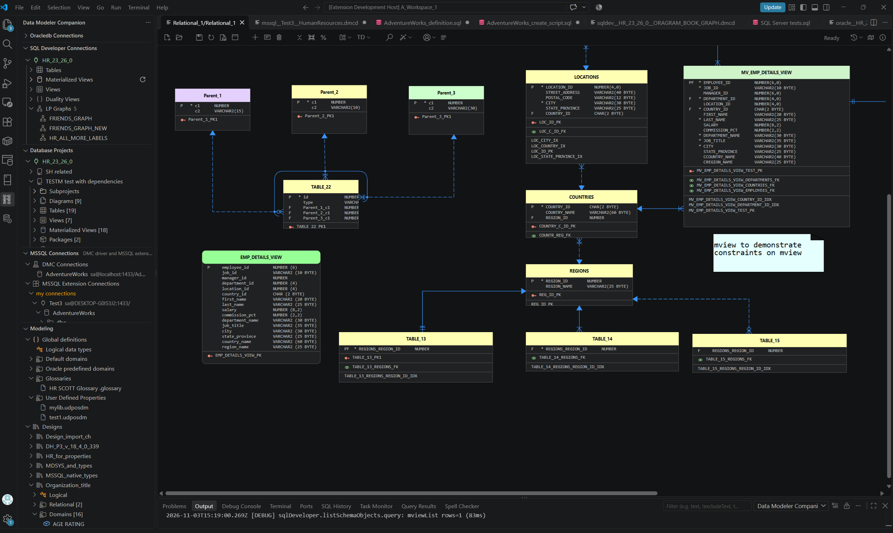

## Contents

- [Get started](#get-started)
- [Connections](#connections)
	- [MS SQL Server](#ms-sql-server)
	- [Oracle](#oracle)
	- [Schemas filtering](#schemas-filtering)
- [Diagramming](#diagramming)
	- [Sources for DMC diagrams](#sources-for-dmc-diagrams)
	- [Quick overview](#quick-overview)
	- [Property graph diagrams](#property-graph-diagrams)
- [MSSQL Server related Show Create Script and Show Definition](#mssql-server-related-show-create-script-and-show-definition)
	- [Show Create Script](#show-create-script)
	- [Show Definition](#show-definition)
- [Database Projects](#database-projects)
	- [Overview](#overview)
	- [SQL Server and Mermaid diagrams in project](#sql-server-and-mermaid-diagrams-in-project)
- [Modeling and SDDM Designs](#modeling-and-sddm-designs)
- [DB Projects Usage Log](#db-projects-usage-log)
- [File formats](#file-formats)
- [Logging](#logging)
- [Documentation and support](#documentation-and-support)
- [License](#license)

## Get started

1. Install **Data Modeler Companion** from the Visual Studio Marketplace.
2. Open the Data Modeler Companion activity bar view.
3. Choose a Diagramming, Database Projects, or Modeling workflow.

Database Projects and SQL Developer connections navigation require **Oracle SQL Developer for VS Code** VS Code extension to be installed. These workflows use connections configured in SQL Developer for VS Code.

For additional details and examples, visit the [Data Modeler Companion public repository](https://github.com/filipsto/dmcompanion).

## Connections

Connections to Oracle Database and MSSQL Server can be created - oracledb and mssql drivers are used for these connections. Each connection type has its own view where connection can be created and diagramming related objects to be presented.

### MS SQL Server

**MS SQL Server connection dialog**
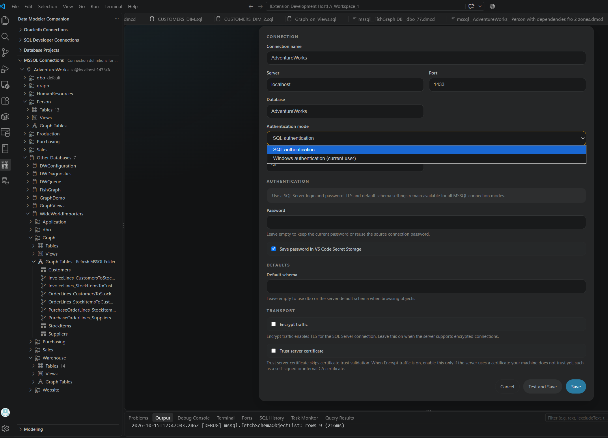

>**Note:** For MSSQL Server connection with windows authentication Microsoft ODBC Driver should be installed

If SQL Server (mssql) VS Code extension is installed then connection groups and profiles are automatically imported.    
Connections appear under two branches **DMC Connections** and **MSSQL Extension connections**.   
For **MSSQL Extension connections** - if there is no default database set then list of available databases appears instead of list of schemas and **Other Databases** branch when default database is set.

**MSSQL Connections**   
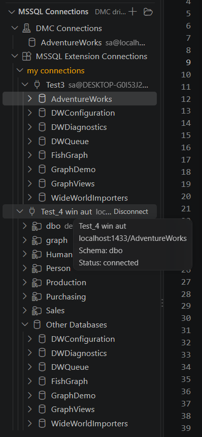

Details on [MSSQL Extension Connections](docs/guides/mssql-extension-connections.md) and related **Show Create Script** on connection tree and diagrams.

### Oracle

**Oracledb nodejs connection dialog**
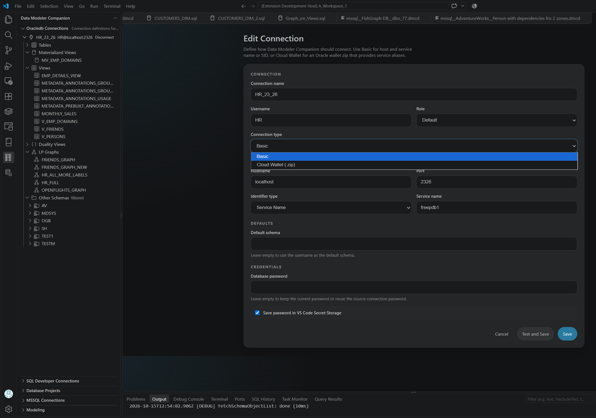

If SQL Developer extension is installed then connections defined in SQL Developer automatically appear/disappear in DMC SQL Developer Connections view and Database Projects view.   
### Schemas filtering
Filters for visible schemas can be defined for connections in Oracledb and SQL Developer Connections views. For MSSQL Server connections filters are defined at database level - it's possible to be defined at connection if default database is set on connection, then filter is for that database.   
Only schemas in filters are listed in connection tree and in dialogs where schema selection is required.

**Filtering of schemas in Oracledb connection**
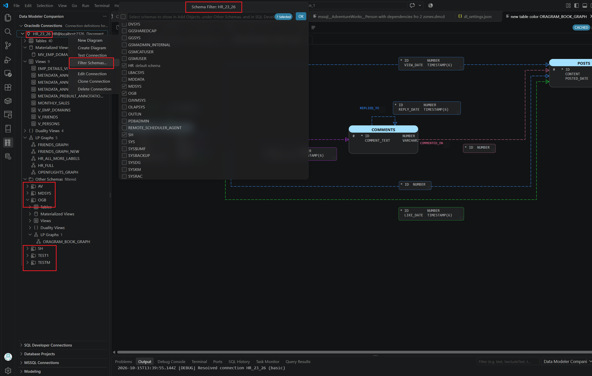

Also color can be set on connections in SQL Developer Connections view.
Connections in Database Projects view inherit schema filter and connection color from connections in DMC SQL Developer Connections view.

**Example for filtered schemas in Add Objects dialog**
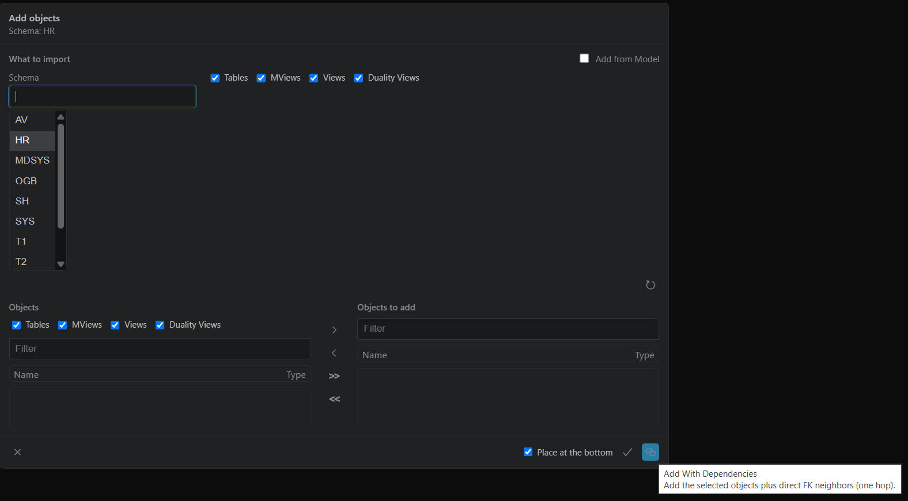

[↑ Back to top](#data-modeler-companion)

## Diagramming

### Sources for DMC diagrams
Create interactive database diagrams in several ways:

- Create connections and use an Oracle Database or Microsoft SQL Server connection tree to create a diagram for schema, object folder, or selection of objects.
- Use **Add Objects** dialog to select a precise scope with schema, object type, and text filters, then include related objects through dependency processing.
- Open diagrams stored in Oracle Database through Oracle REST Data Services(ORDS) Database Actions, or Oracle SQL Developer Data Modeler(SDDM).
- Visualize Mermaid `erDiagram` text selected in the editor or open a Mermaid file. Source Mermaid file is not changed. See [Mermaid tools](docs/guides/MermaidToolArchitecture.md) for more details.
- Open Oracle SQL Developer for VS Code `.dgm` diagram files.

>**Note:** Not null columns can be define in Mermaid `erDiagram` if column comment starts with **NN**   

**Objects supported on diagrams** for Oracle Database sources include tables, materialized views, views, duality views, and Label Property Graphs.

***Example diagram showing tables from Oracle Database MDSYS schema***
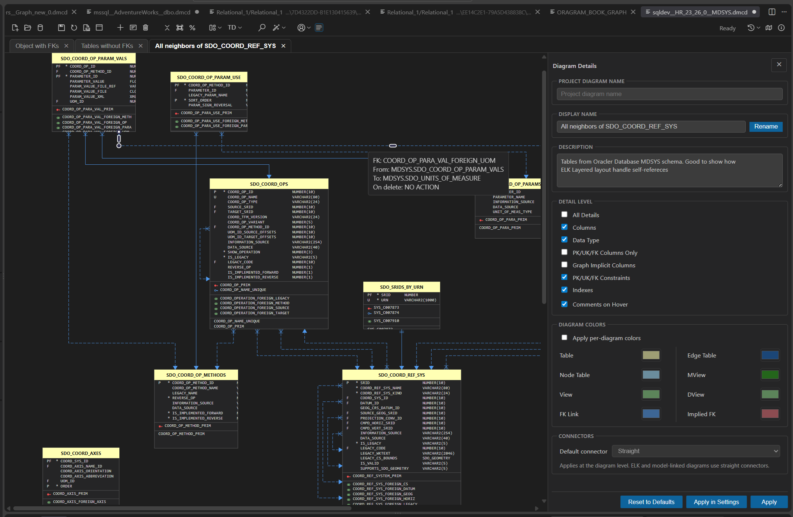

**MSSQL Server sources** include tables, views, node tables, edge tables, and graph relationships.
>**Note:** By default implicit columns for MSSQL Server graph tables are not visible on diagram. Can be changed on diagram details drawer.

>**Warning:** It will take some time to discover MSSQL Server graph relationships from data in edge tables if edge constraints are not defined - see [Edge constraints documentation](https://learn.microsoft.com/en-us/sql/relational-databases/tables/graph-edge-constraints?view=sql-server-ver17)

### Quick overview
Use an Oracle Database or Microsoft SQL Server connection tree to **Create Diagram** for connection, schema,database (SQL Server), object folder, or individual object. Or create empty diagram and add objects using **Add Objects Dialog** or use connection tree to add schema, objects folder or selection of objects with or without their dependencies.

**Add to Diagram With Neighbors** functionality is available on individual object nodes in the Oracledb, SQL Developer, and MSSQL connection trees, including compatible node multi-selections. It reveals the matching open diagram and shows neighbor options over the canvas: **All**, **Parent**, or **Child** direction, a **Number of zones**, or **All Zones**. The starting objects come from the tree, not the diagram selection.   
There are easy to use shortcut variants of that functionality available - **Add to Diagram with Dependencies** (for one parents and children zone) and **Add to Diagram with ALL Dependencies** (unlimited number of zones and involved schemas). Discovery process uses checks to continue or stop when number of objects increase - first check is on 150-object and subsequent 100-object continuation checkpoints. [Neighbor and dependency workflows](docs/guides/add-all-dependencies.md).

On the canvas you can move and resize objects, edit link routes, change labels location and size for foreign keys and edges, add notes, control visible details and colors, apply layouts, easy navigate with **minimap** or **Find Object** drawer.   
Objects selection and optimization functionality allow to create and maintain multiple displays in one diagram workspace stored in distributable .dmcd file.   

>**Note:** For SQL Developer connections related diagram - double click on object on diagram sends a request to SQL Developer to show object details - supported for table, view, mview, duality view and graph node/vertex; double click with mouse is not possible on edge link - use "Open Backing Object Details" in context menu for edge link.

Based on extension setting `dmc.dmcd.autoSplitDatabaseImportDisplays` import from database can create 3 displays when creating a new diagram from a database schema or object folder, automatically create the initial displays `Object with FKs`, `Tables without FKs`, and `Views without FKs`.   

Tool-tips are used to show information not directly expressed on diagram - columns in PK, UK and FK constraints and indexes, comments for tables, views, mviews and columns, objects used in definition of views and mviews, FK name, source, target object and delete rule on FK and implied FK links, labels their properties and backing database object on graph nodes and edges.

**Find Object** drawer allow to filter objects and sort them on name, incoming or outgoing foreign keys thus allowing easy to spot starting point for diagram optimization.  See [Diagram Optimisation](docs/diagramming.md#diagram-optimisation) for details.  

**Objects in Find Object drawer sorted by Incoming Foreign Keys**
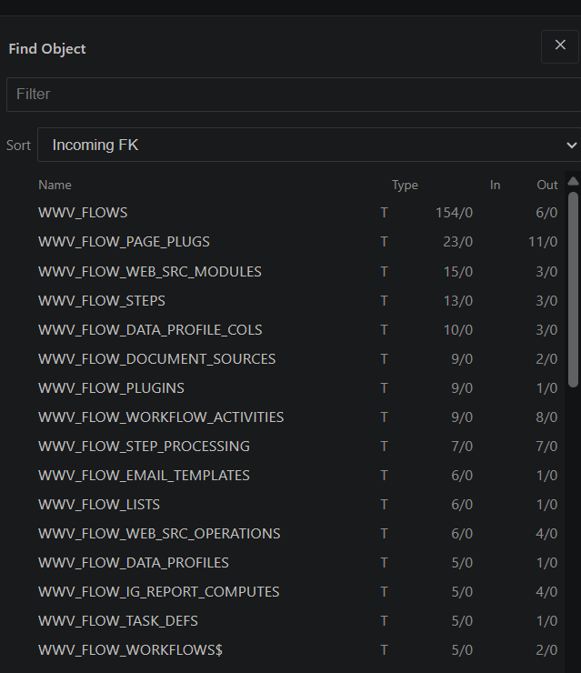

**Colors for object types** can be defined at 3 levels - extension settings, set at diagram level or on selection of objects. It's not possible to select more than one link - **Edge Colors dialog** can be used on graph diagrams to set color for single edge or common color for selection of edges.

>**Note for Oracle Database:** Tables, views, and materialized views referenced directly by SQL Label Property Graphs can be assigned Node/Vertex, Edge, or both roles during Oracle 23+ schema and folder imports. Objects with both roles show two colors. Ordinary schema imports do not resolve synonyms used in Graph definition - LP Graph need to be imported for that.

***Tables in Oracle Database with Node and Edge roles***
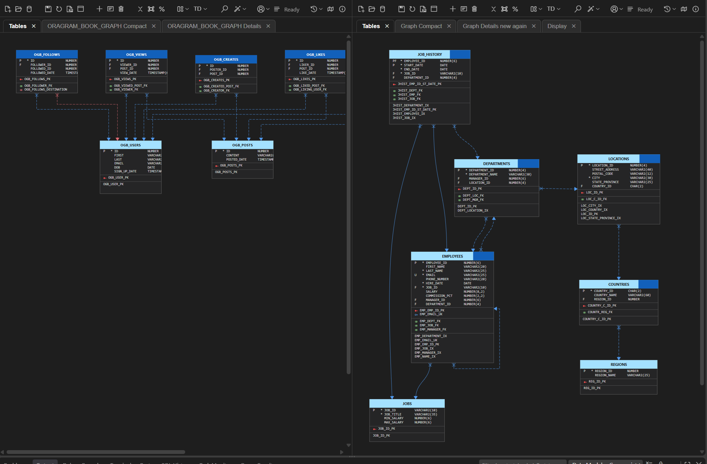

### Property graph diagrams

Oracle Label Property Graphs and SQL Server graph tables receive dedicated graph presentations in addition to standard relational table visualization. Graph displays expose vertices/nodes, edges, labels, properties, comments, and the underlying database objects.
Explicit Oracle graph import resolves local private/PUBLIC synonym chains to actual backing tables, views, or materialized views (Graph definition on synonyms, views and materialized views are supported on Oracle AI Database 23.26.3+). Tooltips show reference to the original object used and synonym path in case synonym is used in node or edge definition. Graph-defined endpoint mappings provide implied FKs without requiring physical PK/FK constraints. See [Property graph diagrams](docs/diagramming.md#property-graph-diagrams) for details.
Two displays are created when representing a graph on diagram - one named compact without edge properties visible and another one having edge properties presented.

Graph relationships are presented as Implied Foreign Key (IFK) links on MSSQL Server graph tables diagram. Single IFK link between edge table and node table is used to represent all relationships between them (see tool-tip on link in the example below):

***Graph tables for Fish Graph example***
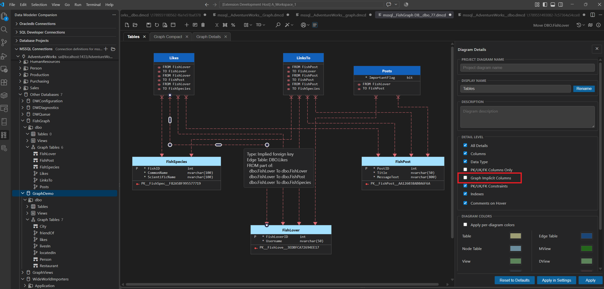

Edge labels and properties get the same color set for the edge.   
Colors set on objects in one display can be applied to another display for the same graph in current diagram.

***MSSQL Server Graph with Edge Colors dialog visible***
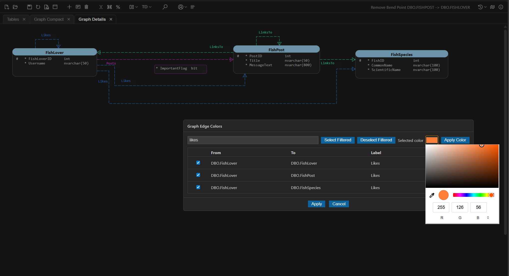

For edge properties presentation - it's possible to reorder properties and make some of them hidden. If there are hidden properties then triangle appears on top right corner.  
**Edge properties Dialog**
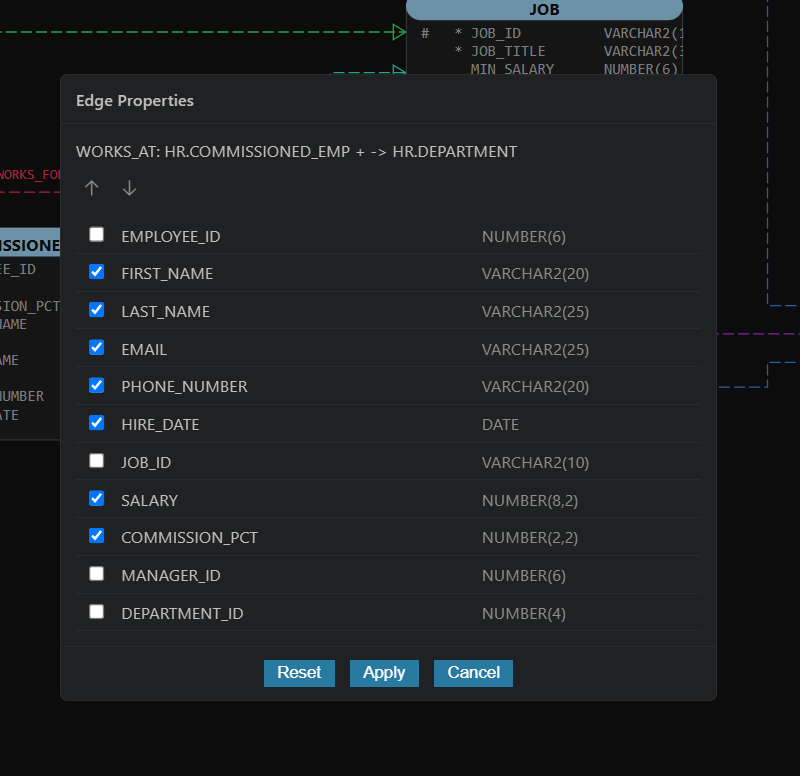

***Oracle Label Property Graph example***
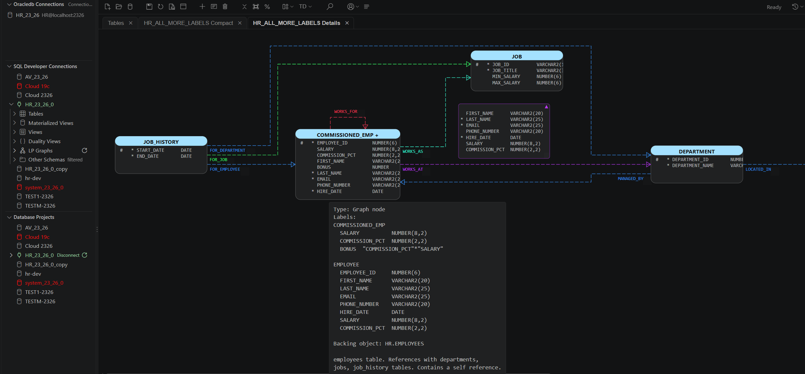

Oracle vertex/node with more than one label have a **+** character added at the end of title. Label appearing as node title can be selected for such nodes:

***Oracle Vertex with more than one label setting***

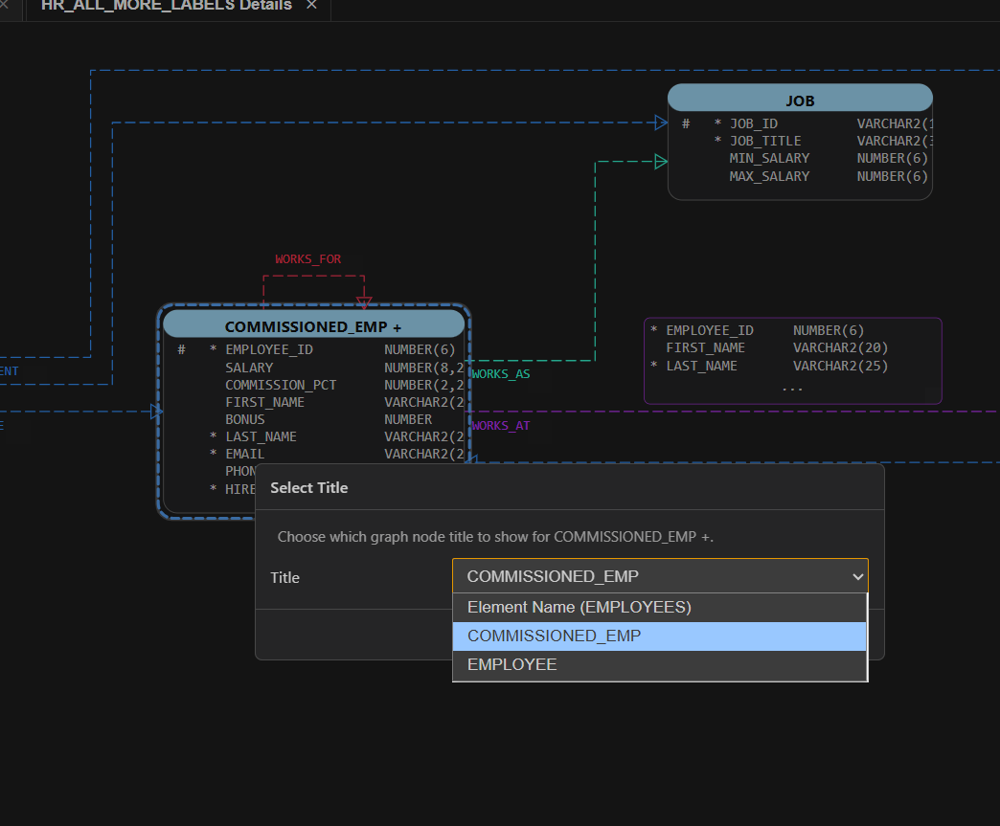

***Oracle Graph defined on synonyms to tables***   
Graph is defined in schema T1 while tables and private synonyms to them are defined in schema T2
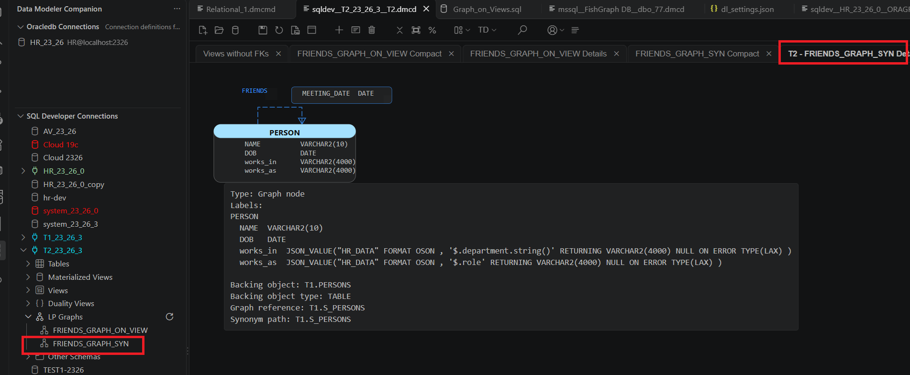

Read the [Diagramming guide](docs/diagramming.md) for creation routes, dependency workflows, graph displays, and examples.

[↑ Back to top](#data-modeler-companion)

## MSSQL Server related **Show Create Script** and **Show Definition**
### Show Create Script

**SQL Server extension functionality** is used to get the script thus it is available only on table and view nodes in MSSQL extension connections and on diagrams created using such connection - not available on DMC MSSQL Server connections. Also works on selection of objects on connection tree and diagram. **Show Create Script(All Objects)** is also available On diagram.   
Script is shown in new editor as it comes from MSSQL extension - no option to change details level - all related definitions (including triggers) are included.   
More details in [MSSQL Extension Connections](docs/guides/mssql-extension-connections.md) document.   

### Show Definition
Scripts generated with **Show Create Script** functionality are too verbose, include many details and are difficult to read. Idea behind **Show Definition** is to provide more simplified view on definition of tables and views. By default indexes, check constraints and comments are not included in generated script, quoting and GO statement are suppressed. That can be  changed in DMC extension settings.   
All settings are in the **SQL Server** group (`dmc.mssql.showDefinition.*`).

| Setting | Default | Effect |
| --- | --- | --- |
| `includeCheckConstraints` | `false` | Include check constraints. |
| `includeIndexes` | `false` | Include indexes that do not back a primary key or unique constraint. |
| `includeComments` | `false` | Include `MS_Description` object and column comments as `sys.sp_addextendedproperty` calls. |
| `quoteIdentifiers` | `false` | Bracket every identifier. When off, only identifiers that need it are bracketed (see [Identifiers](docs/guides/mssql-ddl-formatting.md#identifiers)). |
| `useGoBatchSeparator` | `false` | End every statement with `;` followed by `GO`. When off, `;` is on its own line and `GO` appears only around views. |
| `constraintsAsAlterTable` | `true` | Emit unique and check constraints as separate `ALTER TABLE` statements after `CREATE TABLE`, so only the primary key remains inline. When off, they are listed inside `CREATE TABLE`. |
| `includeDiagramEdgeConnections` | `true` | For an edge table without a declared `CONNECTION` constraint, write an inline `CONNECTION` built from the node pairs already known to the diagram. |   

Functionality is available on table and view nodes in all SQL Server connections and on diagrams created using such connection. Also works on selection of objects on connection tree and diagram. **Show Definition(All Objects)** is also available On diagram.  
For more details look at [DDL formatting](docs/guides/mssql-ddl-formatting.md)  document.

[↑ Back to top](#data-modeler-companion)

## Database Projects 
### Overview
Database Projects extend Oracle SQL Developer for VS Code with a project-oriented view of Oracle Database objects. A project or subproject can span schemas and object types, store a focused object scope, and own diagrams that document that scope.

Use object filters and dependency expansion in Edit project dialog to assemble a project. For table, view and materialized view ALL_CONSTRAINTS view is used to get parent and child dependencies for one hop. For view, materialized view and PL/SQL objects ALL_DEPENDENCIES view is used to get used object (again for one hop).   
That's usual workflow but if you have already diagram created with DMC then can use **Add Current Diagram With Objects** functionality from project context menu. In this way project can be created based on diagrams in Oracle Database **created with Database Actions(ORDS)** or **Exported to Database from SDDM**, or from diagram created with **Add with With Neighbors/All dependencies** functionality on object in connection tree - that functionality tracks all foreign keys based dependencies for parents and children for defined number of zones or without limit of levels and involved schemas.   
Using diagram stored in database by SDDM is the fastest **transition from SDDM models to database projects**.  

Object types supported in Projects:
- table
- view
- materialized view
- duality view
- domain
- dimension
- sequence
- procedure
- function
- package
- package body
- trigger
- synonym
- directory
- label property graph
- analytic view
- assertion (Oracle AI Database 23.26.1+)

After creating project objects tree you can:
- Open object details in Oracle SQL Developer for VS Code.
- Reopen in SQL Developer recently used objects from the [DMC DB Projects Usage Log](#db-projects-usage-log) bottom-panel tab, with text, schema, object-type, and connection filters.
- Create project-owned diagrams or add an existing diagram to a project.
- Generate **SQLcl filter files** for the SQLcl `project export` command.
- Generate **SQLcl DDL generation scripts** that extract DDL for objects in a project or subproject and store that DDL in separate file into file system.
- Export and import portable `.dmcproj` bundles containing project structure, object selections, and project diagrams. UI supports schema remapping if change of target schemas is required.
- Use **Show DDL** in context menu for Analytic View, Materialized View, Dimension, Property Graph and Assertion to get their DDL in separate editor.
- Use **Verify Objects in Database** in order to check if all database objects included in projects are really accessible in database - recommended step after import of database project.
- Can get diagram thumbnails as tool-tip for diagram nodes in Database project tree;

>**Note:** VSCode limits the size of tool-tip in nodes to 100000 characters, thus there will be no diagram thumbnail for large diagrams - only description will appear if it's defined.

>**Note:** System tables created by Oracle to support assertions (names prefixed with `ORA$SA$`) are hidden in connection trees, Database Projects and dependency processing.

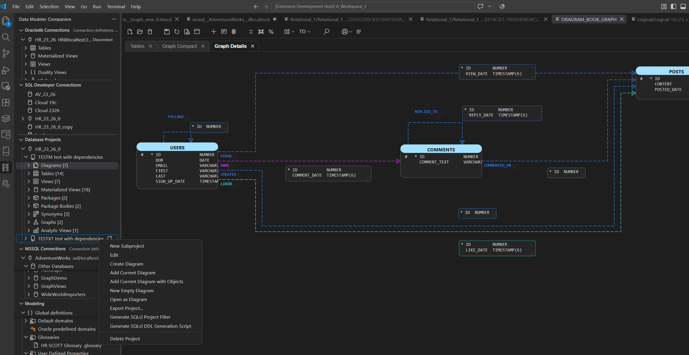

Read the [Database Projects guide](docs/database-projects.md) for project organization, SQLcl generation, dependency processing, and bundle transfer.

>**Note:** Content of Database projects and diagrams is stored in Database connection schema in two tables - DMC_PROJECTS and DMC_PROJECT_DIAGRAMS.

### SQL Server and Mermaid diagrams in project

**Add Current Diagram** can store SQL Server and Mermaid-origin DMCD snapshots in an Oracle-backed project or subproject. Those diagrams are complementary for projects spanning different database types. Those diagrams are stored as they are only adding project information for them. Opening SQL Server diagram from projects keeps its relation to source connection and SQL Server database and has full functioning SQL Server related functionality.
Schema remapping is not applied when import non Oracle diagrams.   
For details see [Project Diagrams](docs/diagramming.md#project-diagrams)

[↑ Back to top](#data-modeler-companion)

## Modeling and SDDM Designs

Import Oracle SQL Developer Data Modeler (SDDM) designs into the **Modeling** view. Data Modeler Companion transfers the supported logical and relational artifacts and preserves supported diagram positions, routes, arcs, colors, notes, and presentation.
>**Note:** At current stage DMC doesn't provide editors to change transferred designs. One exception are diagrams - they can be changed. If diagrams are changed but metadata in source design are also changed then use "Reimport Design from SDDM" functionality - it'll update metadata in models files without changing diagrams.   

**Modeling support includes:**

- Relational models with tables, materialized views, views, columns, keys, indexes, foreign keys, and diagram layouts. Support for Implied Foreign Keys (IFK).
- Logical models in Barker notation, including entity hierarchies rendered as box-in-box structures.
- Relationships and foreign keys organized and presented including imported arcs.
- Relationship attributes as metadata and presentation on diagram.
- Resolution and rendering of supported SDDM logical and physical data types, domains, precision, scale, and size definitions including user defined native database types. Support for global(default domains) and design level domains.
- SDDM remote-objects from same or another design including refresh of their imported definitions from the recorded source designs.
- Rich hover information for objects, attributes, columns, relationships, graph elements, domains.
- Diagram thumbnails for diagram nodes in models tree - appear as tool-tip when hover over diagram node in model tree.
- Embedding of diagram into diagram with navigation to real diagram forth and back.
- HTML and PDF reports for tables and materialized views in relational model and entities in logical model, including links to diagrams where each object is used; Option in report generation to include dynamic and user-defined properties in report.
- Use SQL Developer to show object details in database - that is possible if relational model is implemented in Oracle Database. Then double click on entity or table (in model tree or on diagram) will show details for mapping object in database.

>**Note**: PDF generation requires a location of supported Microsoft Edge executable configured in Data Modeler Companion settings. For Windows  MSEdge is preinstalled, related distributions should be installed on Mac and Linux.    

***Logical model diagram with diagram preview in model tree***
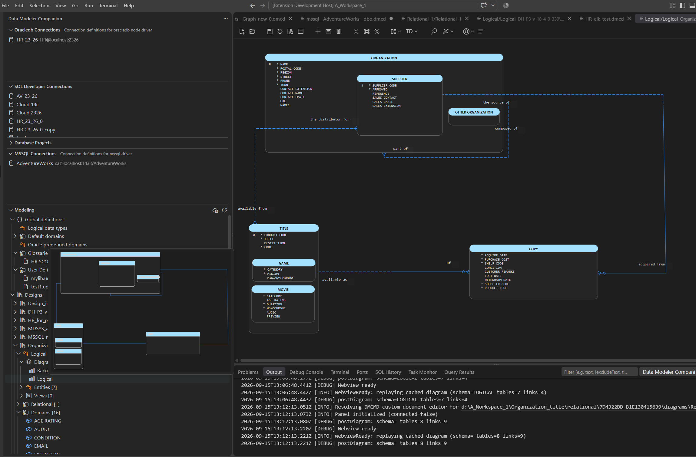

***Corresponding relational model diagram with rich tool-tip for domain definition and design level domains in design tree***
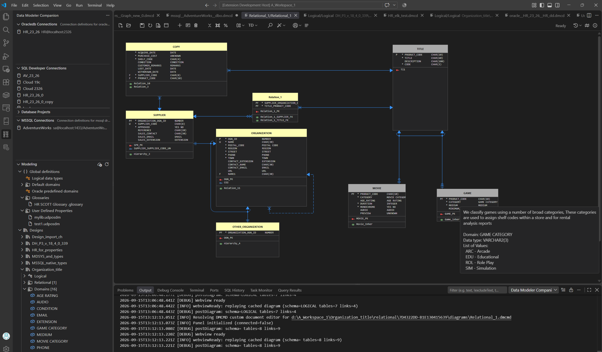

**Color for object types** is resolved in way similar to what is in SDDM - it's based on definition of source dl_settings.xml imported into dl_settings.json located in target DMC design directory. Two paths to define a color at design level:
- object type color in dl_settings.json -> object type color at diagram level -> color set at object/synonym at diagram;
- based on classification - takes color defined in dl_settings.json;   

Those colors can be changed at diagram level or specific color can be set at object or graphical synonym on diagram;
>**Note:** Diagrams in Oracle SQL Developer Data Modeler can have their own background color and usually it's white. Use light VS Code theme For better color reproduction especially when color with transparency is used.

***dl_settings.json is the place to set color for DMC design object types similar to extension settings for .dmcd diagrams***    
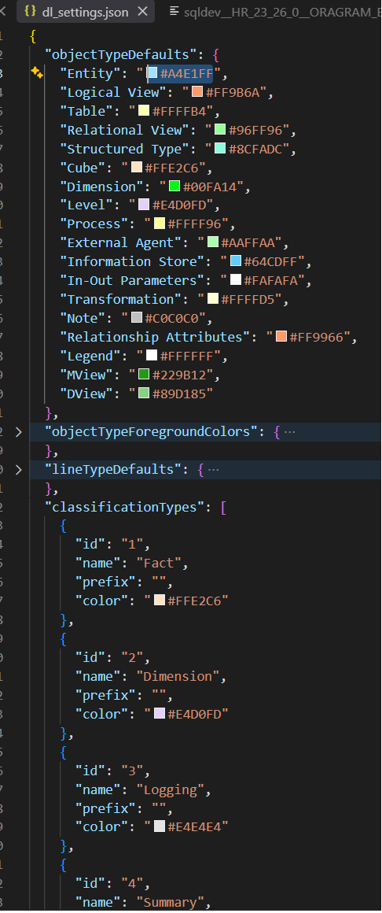

Report templates and Objects report configurations created with SDDM can be used in report generation as starting point and changed what really go into report using filtering on objects and diagrams. HTML and PDF reports are generated with Table of Content (TOC) to navigate directly to content of object, navigational foreign key names (links) on content part and on diagram, navigation from content to diagram where objects is used and back to content part from diagram. HTML reports retain rich tool-tip information provided on DMC diagrams - not supported on PDF reports.

>**Note:** Information included in example models and therefore appearing in reports is for illustrative  purpose only.

>**Note:** All reports are generated in light theme

***Table details showing identity column and Default on Null(Id and DoN in M/Mandatory column)***
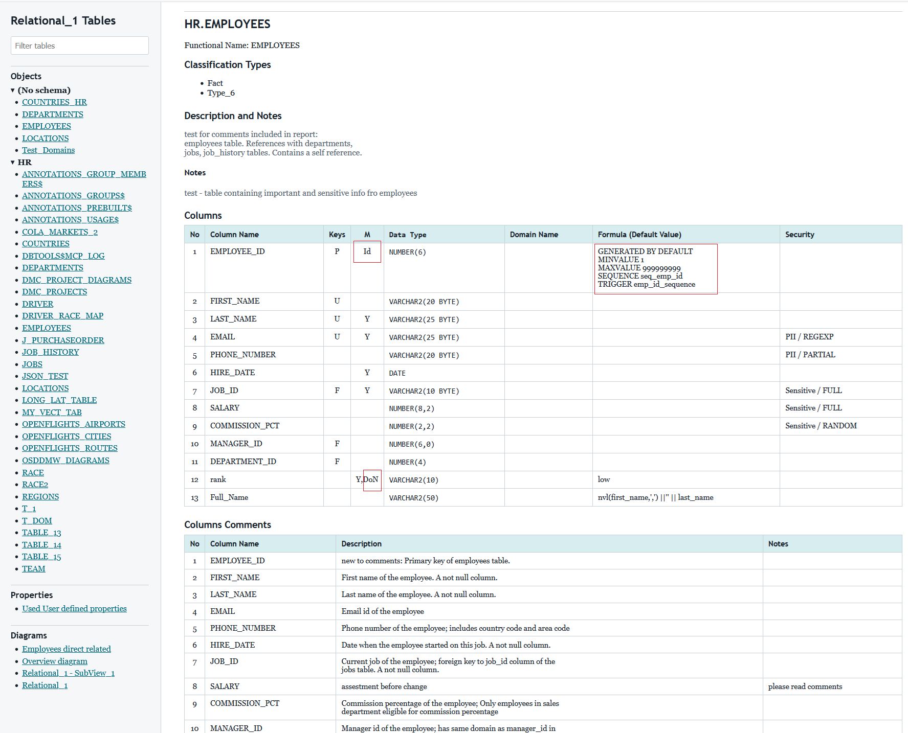
 

***More table details in PDF report including dynamic properties and UDP at table level***
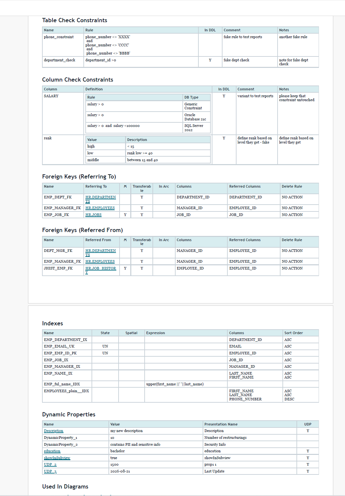

***Report Example for overview diagram (embedding a diagram into another diagram from the same or other models)***   
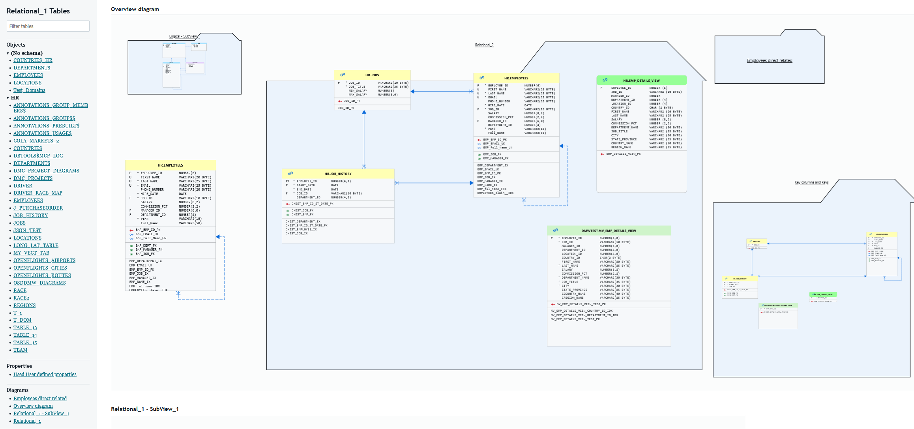

>**Note:** Embedded diagram from SDDM Data types model won't be rendered in composite view - they'll appear as template. Overview diagrams in report are not supported in original SDDM reports.

***Diagram in HTML report with rich tool-tip support***
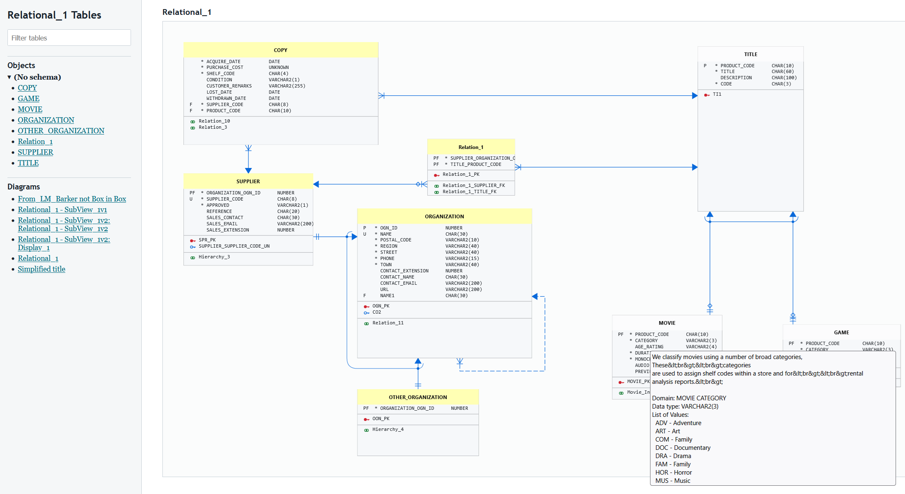

**PDF report for entities in Logical model**    
Implementation tables for mapped relational models are included in report
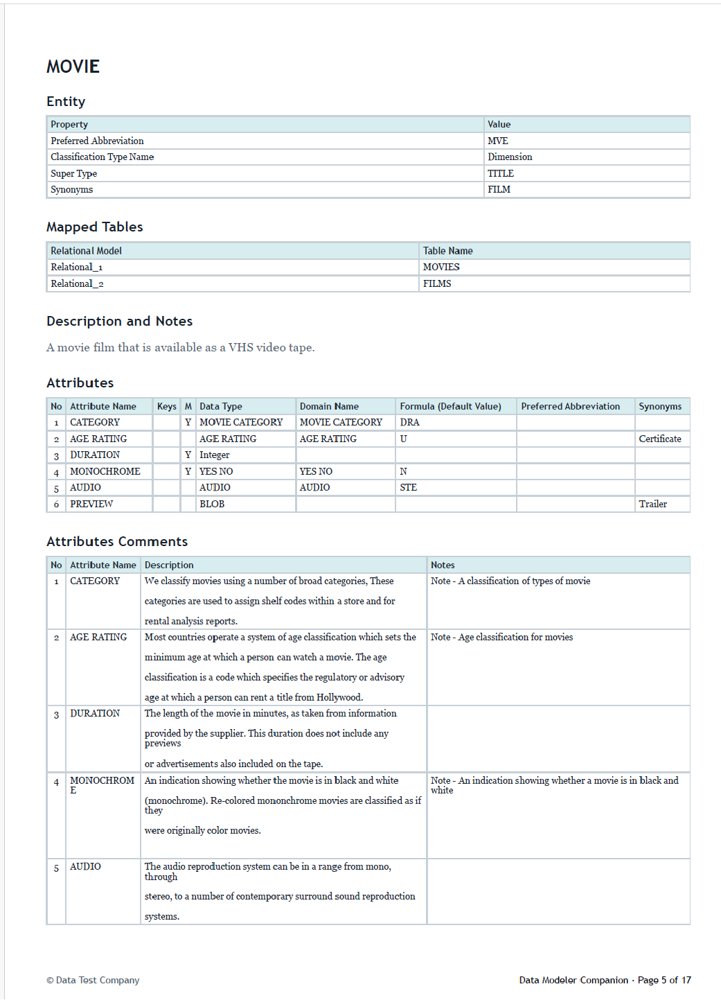

**PDF report - Second page for Entity Movie**   
Constraints (coming from domains in this case) and User defined and dynamic properties defined on that entity
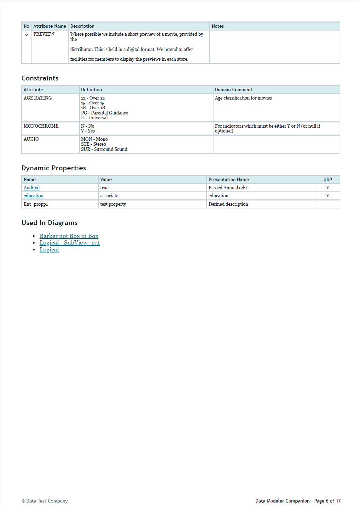

**PDF report - Logical model diagram with nested implementation diagram**   
By default data type for attributes is not shown on diagram with Barker notation. That can be changed at diagram level - data types are visible on diagram below
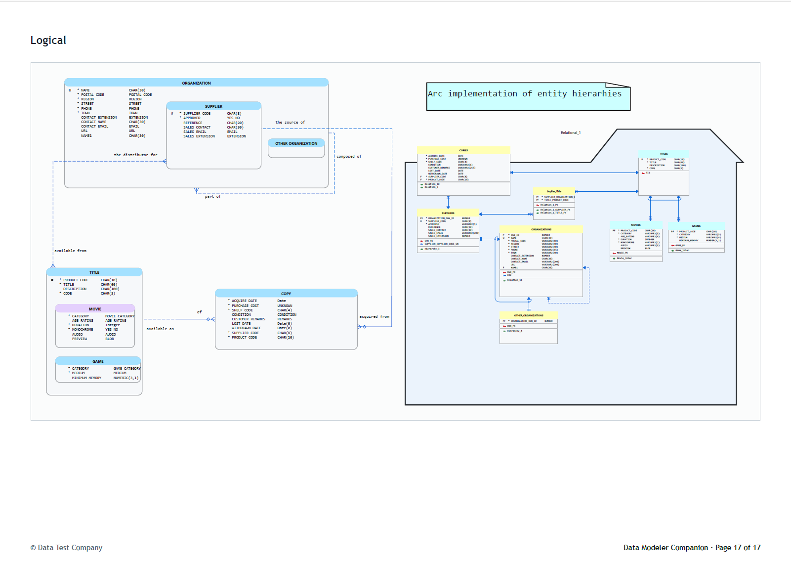

[Read the report guide](docs/guides/tables_entities-report.md) for more info on report generation and custom CSS tuning.

[↑ Back to top](#data-modeler-companion)

## DB Projects Usage Log ##   

For Oracle Database related objects DMC can send a request to SQL Developer extension to show object details.
The usage log records distinct objects successfully opened through SQL Developer from Database Projects, the SQL Developer Connections tree, the Modeling tree, or diagrams. It keeps the most recently used first, and persists locally across workspaces in the current VS Code profile. For logical model objects, it records the mapped database object. Its default limit is 150 objects, controlled by **Database Projects: Usage Log: Max Entries**. Connection cells reuse DMC connection colors.   
**DB Projects Usage Log window**
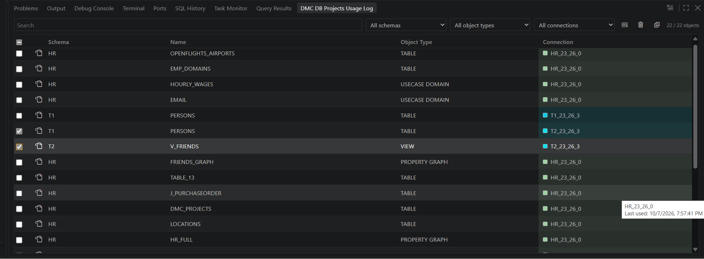

DB Projects Usage Log window can be made visible using **Ctrl+Shift+P** and command **Show DMC DB Projects Usage Log**.   
Entries can be filtered using text filter and/or filter by schema, object type and connection. Entries can be selected and removed from log if not needed any more.

[↑ Back to top](#data-modeler-companion)

## File formats ##

- `.dmcd` is a self-contained diagram that owns its model, layout, and visual state.
- `.dmcmd` is a design/model-linked diagram whose layout and presentation are associated with an imported DMC design.
- `.dmcproj` is a portable Database Projects archive bundle used in export/import of project.
- `.dgm` is an Oracle SQL Developer for VS Code diagram that can be opened by Data Modeler Companion.
- `.mmd` and `.mermaid` files containing Mermaid `erDiagram` definitions can be visualized as editable diagrams.

## Logging

The **Data Modeler Companion** output channel uses `dmc.logging.level`. At `info`, database/schema and folder/selected-object diagram imports report their host-side duration and outcome, excluding waits for dependency confirmation dialogs. At `debug`, major import stages and existing per-query timings are also available. Switching it `off` disables all logging. Editor opening does not measure subsequent webview layout or rendering.

## Documentation and support

- [Documentation index](docs/README.md)
- [Diagram examples](examples/README.md)
- [Issue tracker](https://github.com/filipsto/dmcompanion/issues)

The public repository contains detailed workflows examples, and release media. 
## License

All example .dmcd files and documentation are free to download and use. All .dmcd diagrams can be modified and redistributed. 

[↑ Back to top](#data-modeler-companion)
