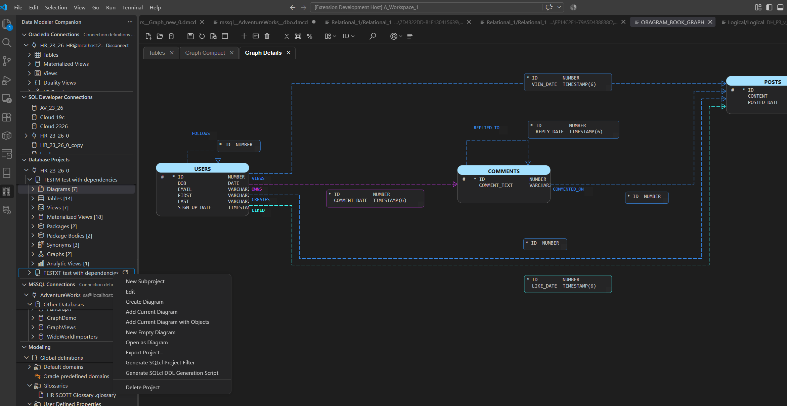
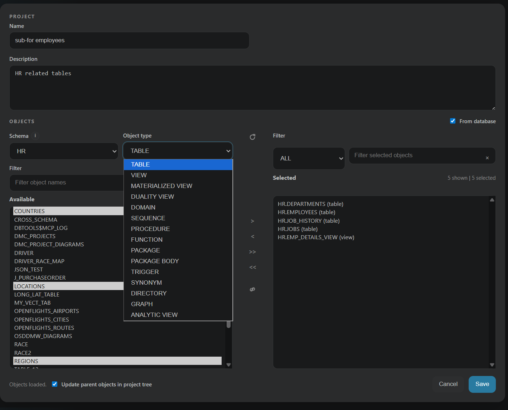
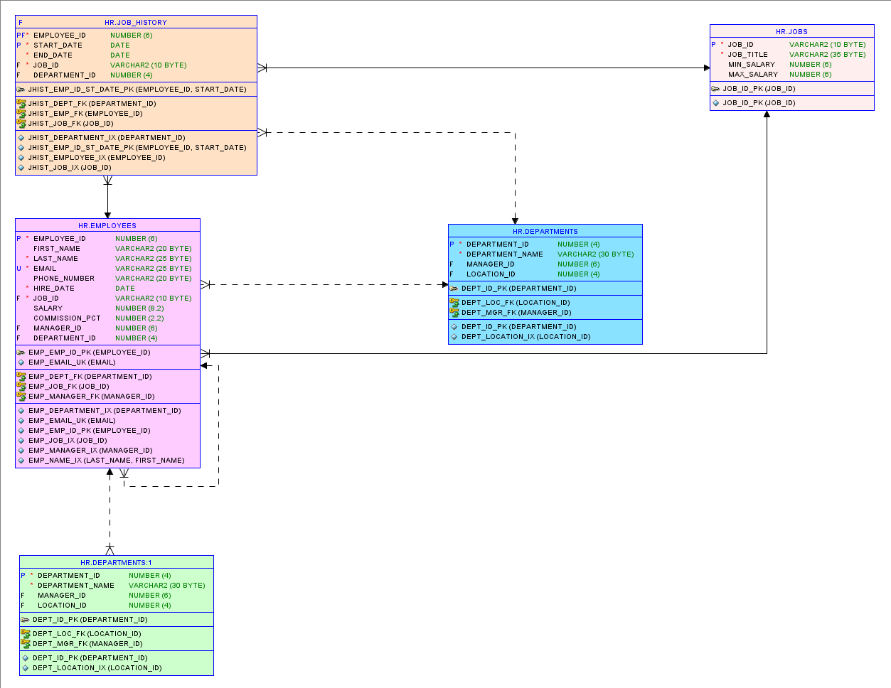
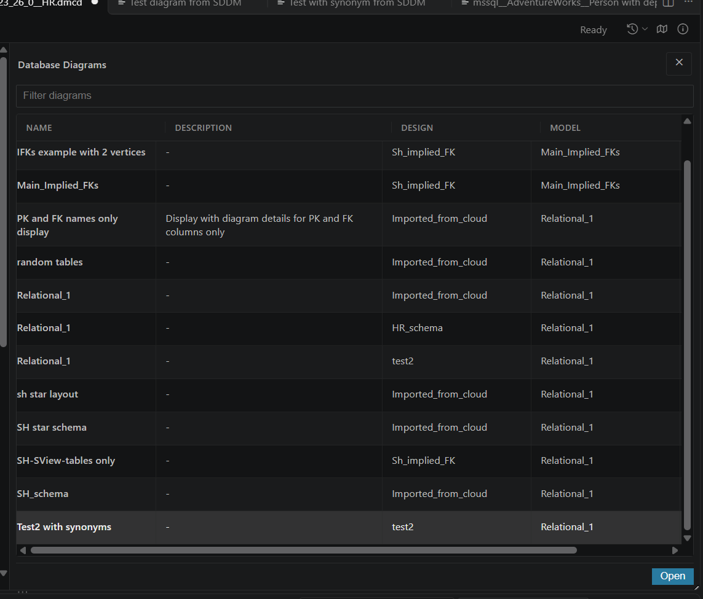
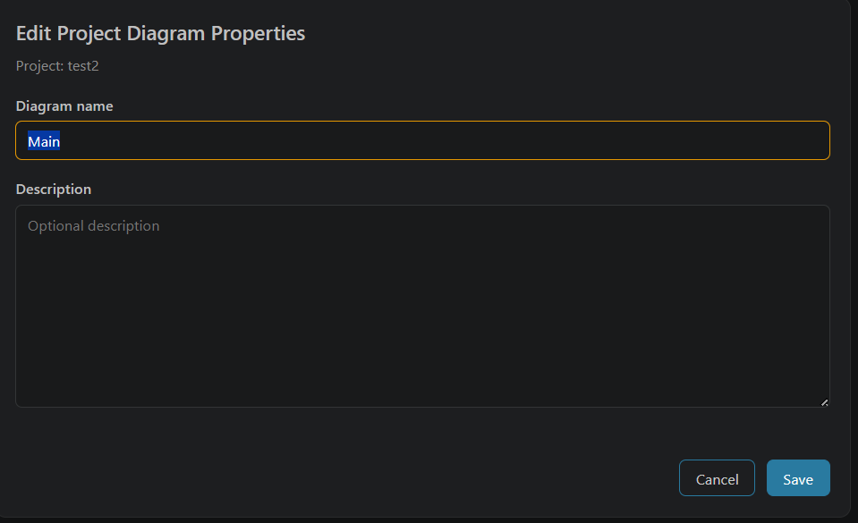
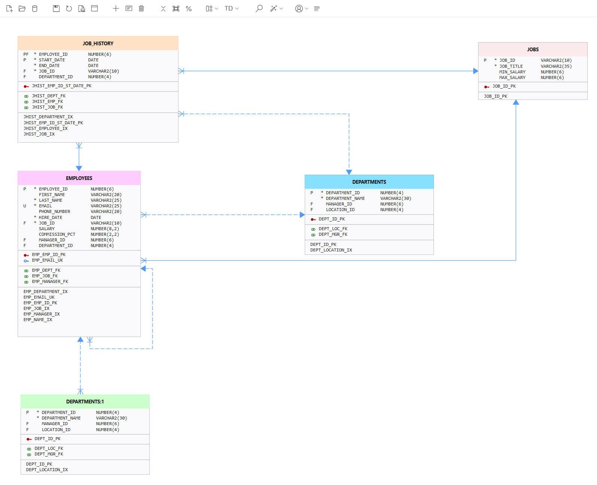
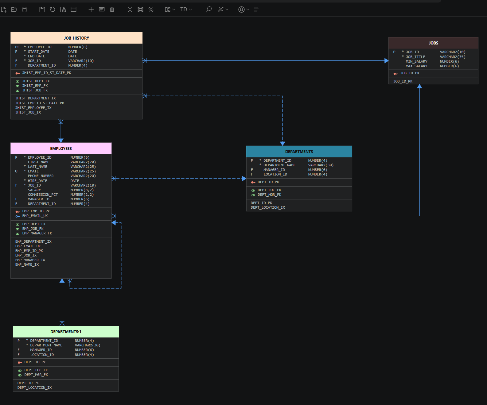
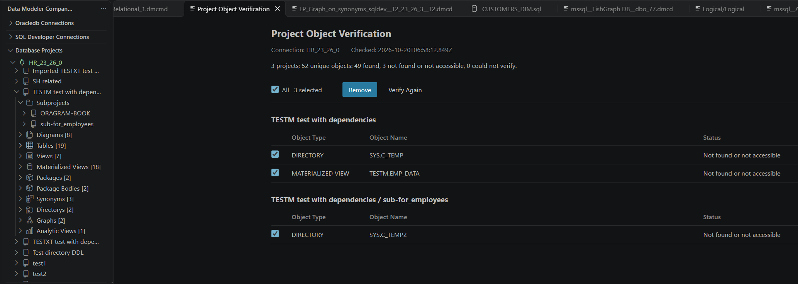
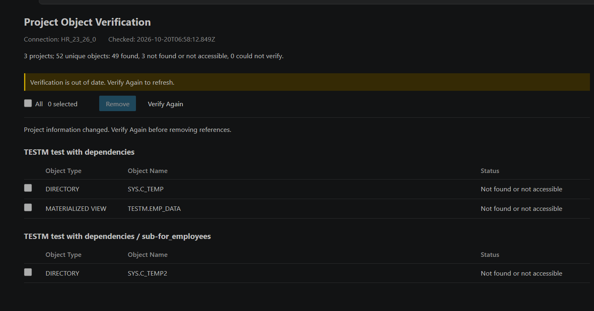

# Database Projects

Database Projects extend Oracle SQL Developer for VS Code with a project-oriented view of Oracle Database objects. Install and configure SQL Developer for VS Code first - Data Modeler Companion uses its saved connections.

## Organize database objects
### Using Add objects dialog
Create projects and sub-projects that span schemas and supported Oracle object types. The object-selection workflow filters the available and selected scopes and can expand a selection with database dependencies. For table, view and materialized view ALL_CONSTRAINTS view is used to get parent and child dependencies for one hop. For view, materialized view and PL/SQL objects ALL_DEPENDENCIES view is used to get used object (again for one hop).

In the right-hand **Selected** list, **<<** removes all objects visible under the current text and object-type filters. Hidden objects remain selected, and the filters stay unchanged. Clear the text filter and set the object-type filter to **ALL** to remove the entire selection. This applies when creating or editing projects and sub-projects, and when assigning objects.

A root project selects from its live database connection.   
A sub-project can start with its parent project's object scope or add objects from the database. There is an option to propagate newly added database object up on parent projects tree. Thus project can be created using top-down (add first all objects to project and then split to subprojects) or bottom-up (start with objects in sub-projects propagating them up to parent projects). Sub-projects can have objects that are not propagated to parent projects - those could be objects that can be shown on diagram to reveal some dependencies to other objects.   

>**Note:** Only objects belonging to root project are processed in generation of SQLcl **project export** filters and SQLcl DDL generation script.

Dependency processing resolves related live database objects and stores the resulting typed object selection. Used SYS objects (based on dependencies processing) are added to project but never included in generated filters or SQLcl DDL generation script - exception is **directory** object - they are always owned by SYS.

Database Projects preserve database-returned owner and object-name casing for every supported object type. Case-distinct identifiers remain separate through selection, persistence, dependency expansion, conflict editing, and project transfer. Text search remains case-insensitive. SQLcl output preserves casing and quotes identifiers where needed.

[Learn about project dependency expansion](guides/database-projects-add-with-dependencies.md)

### Add Current Diagram

Select the source diagram, then choose **Add Current Diagram** on a project or subproject. SQL Server diagrams and diagrams converted from Mermaid files or editor text can be stored alongside Oracle diagrams without adding their objects to Oracle project membership. The complete DMCD snapshot is stored, including its displays and layouts; the Mermaid source file or text is not modified or linked to the project.

SQL Server and Mermaid diagrams have distinct tree icons and vendor labels in their tooltips. They can be organized in any subproject. **Ctrl+S** saves to the owning project's Oracle storage connection, independently of the diagram's source connection. Viewing and saving a stored snapshot does not require the SQL Server source connection. Double-clicking its objects does not request SQL Developer object details.

Oracle diagrams must use the same SQL Developer connection as the target project. Native OracleDB (`oracledb`) diagrams remain blocked; changing their connection type and connection name in the DMCD file is an explicit user action, not an automatic conversion. Unknown-source diagrams are not treated as Mermaid diagrams.

#### Storage Schema

`DMC_PROJECT_DIAGRAMS.DB_TYPE` is `NUMBER(4) DEFAULT ON NULL 0`: `0` for Oracle, `1` for SQL Server, and `2` for Mermaid. 

Project ownership metadata stores `storageConnectionName` and `dbType` separately from source connection metadata. Project objects, verification, dependencies, and SQLcl generation remain Oracle-only. Project bundle version 2 carries the diagram type; older bundle versions are not supported. On import, SQL Server and Mermaid source metadata, schemas, model, and layout stay unchanged; only project ownership is replaced.

### Add Current Diagram With Objects

This command remains restricted to Oracle diagrams using the target project's SQL Developer connection. SQL Server and Mermaid diagrams are blocked, even when their object names also exist in the Oracle database.

**Add Current Diagram With Objects** functionality will add current diagram to project(sub-project) and also will add objects on diagram to project. It's important that objects on diagram should exist in database. So following source of diagrams can make it easier to start with projects:
- Open diagrams stored in Oracle Database through Oracle REST Data Services(ORDS) Database Actions, or Oracle SQL Developer Data Modeler(SDDM).
- Open Oracle SQL Developer for VS Code `.dgm` diagram files.

In this way project easily can be created from SDDM relational model (or subset of model) using SDDM subview diagrams exported to database.
Here is an example:
1. SDDM diagram exported in database:

2. On open connection in "SQL Developer connections" view (not in "Database Projects" view) use **New Diagram** functionality to create new `.dmcd` diagram - close **Add Objects** dialog. Click on **Open diagram from database** icon on diagram tool bar. Import from database dialog appears, select required diagram and use **Open** button or double click on it to transform that diagram to DMC diagram.   
**Import diagram from Database dialog**

3. On target project use **Add Current Diagram with objects** in order to add diagram and objects to project/subproject - diagram and objects are added to project and after that **Edit Project Diagram Properties** dialog appears and title and description can be provided. Using cancel button with leave diagram with the name **Main** already set.

**Edit project Diagram Properties**

**Imported SDDM diagram - light theme**

**Imported SDDM diagram - dark theme**

## Connection colors

In Data Modeler Companion's **SQL Developer Connections** view, right-click a connection and choose **Set Connection Color...**. Select a color using the picker or enter `#RGB` or `#RRGGBB`, then choose **Save**. **Cancel** leaves the connection unchanged. Choose **Reset Connection Color** to restore the default theme icon.

The chosen color appears on both the connection name and its status icon in **SQL Developer Connections** and **Database Projects**, in light and dark themes. Icon shapes indicate connection status. Setting a color does not require connecting to the database.

Connection color assignments are stored locally in Data Modeler Companion's VS Code global state and persist across reloads and workspaces in the same profile. 

These colors do not change SQL Developer's own connection colors and are not included in project exports. Connection assignments are not opted into Settings Sync, although VS Code may sync the theme customization according to your Settings Sync preferences. Colors are associated with connection IDs; a recreated connection with a new ID does not inherit the old color.

## Verify project objects

Right-click a project and choose **Verify Objects in Database** to check its object references and those in all nested sub-projects using the project's Oracle connection. Shared objects are checked once. SYS-owned objects other than directories are excluded from checks, totals, verification statuses, reports, and removal candidates; their project membership and normal tree visibility are unchanged. Verification shows progress and never changes project contents or database definitions. Cancellation discards results when the active query returns; it does not interrupt in-flight SQL.

Object tree items show **Found**, **Not found or not accessible**, or **Could not verify**, with the check timestamp in their tool-tip. Catalog query failures and unsupported checks are not treated as missing objects. An existing object counts as found even if its database compilation status is invalid; synonyms are checked for existence, not whether their targets resolve.

A verification webview lists only objects not found or not accessible and failed checks, grouped by project path, with **Object Type**, **Object Name**, and **Status** columns. Connection, project, and object names retain their literal spelling, including underscores, hyphens, and backslashes. Each project membership has an initially unchecked checkbox; failed checks cannot be selected for removal. An object repeated in several projects appears under each membership, while summary counts refer to eligible unique database objects. If all eligible objects are found, a notification appears instead; a scope with no eligible objects reports nothing to verify. An already-open report updates in place, including empty results, when **Verify Again** is used. Catalog absence is not proof of deletion: objects can exist without being visible to the connection.

### Optional reference removal

**Database Projects: Verification Allow Remove Not Found Objects** (`dmc.databaseProjects.verification.allowRemoveNotFoundObjects`) defaults to **false** and applies across workspaces. When enabled, eligible report check-boxes and the **Remove** button become available. The button's tool-tip is **Remove Selected from Project**. The action bar remains visible while scrolling, with a selected-membership count, an **All** checkbox for eligible memberships, and **Verify Again**. With the setting disabled, the report remains viewable but selection and removal are disabled. Setting changes update the open report without reloading VS Code and never remove anything automatically.

Select individual memberships in the report and choose **Remove**. The extension rechecks selected objects and excludes those now found. A failed recheck blocks removal. Review the final confirmation, including affected projects and references; cancel it to keep all references. Objects may still exist but be inaccessible; removing a reference does not drop a database object, change a diagram, propagate through parent projects, or remove memberships from other projects.

**Result of verification**

The panel shows completed changes and any failure, marks changed reports stale, clears selection, and disables further removal until **Verify Again** produces a new report.
Removal of object entries in project is suspended if project meanwhile is edited. If project change happens in current VS Code session then suspension is immediate. If change happens outside current VS Code session then suspension happens before removal is executed. In order to proceed verification need to be re-run.

**Suspended objects removal**

Data refreshes, connection changes, project edits, and a new verification invalidate old report selections; theme changes preserve them. Reports and tree indicators are session-only. Closing a report while confirmation is pending prevents removal. An idle or hidden panel does not block another verification; only active queries and reference-removal operations hold a connection guard. The report does not restore across extension reloads.

## Directories

When loading **Directory** objects from the database, the selected schema identifies the user receiving a direct directory grant, not the directory owner. The list uses `ALL_TAB_PRIVS` with `TYPE = 'DIRECTORY'` and `GRANTEE` equal to the selected user. Multiple privileges, such as `READ` and `WRITE`, produce one directory entry. Grants through roles or `PUBLIC` are not expanded.

Only grants visible to the current connection through `ALL_TAB_PRIVS` can be listed. A connection browsing another user may not see all that user's grants. Directory references retain their actual owner, normally `SYS`, and exact name casing when added to projects. Parent-project-only selection remains based on the parent's stored object scope.

 [SQLcl project filters](guides/database-projects-import-export-and-sqlcl.md) continue to exclude all `SYS`-owned objects, including directories. Project membership and portable bundles retain them.

SQLcl DDL generation scripts include directories. Directory names are quoted only when required by the database identifier policy. A missing or invisible definition or unavailable path produces a diagnostic comment instead of a fabricated statement. All other `SYS` objects remain excluded. See the [DDL generation guide](guides/database-projects-import-export-and-sqlcl.md#directory-ddl) for permissions, database-version requirements, and path portability.

## Relational dimensions

Assign Oracle relational `DIMENSION` objects to projects and sub-projects using the object-selection dialog. They appear in a **Dimensions** folder and retain their owner and name through project saves and bundle transfer. These objects are separate from analytic-view attribute dimensions and are not diagram objects.

Double-click a dimension, press **Enter**, or right-click and choose **Show DDL** to open its `CREATE DIMENSION` statement in a named, untitled SQL editor. SQL Developer does not support native dimension object details, so dimension activation never requests that - custom DDL is generated instead.
>**Note:** Double-click on dimension node and analytic view node is exception from standard Double-click operation on object node to send request to SQL Developer to show object detail- since there is no support for Dimension object in SQL Developer **Show DDL**  operation is executed.

**Include Schema in DDL** (`dmc.databaseProjects.includeSchemaInDdl`) defaults to **true**. Disable it to omit schema prefixes from the dimension name, level table references, and join keys consistently. This changes only the generated SQL, not the snapshot's owner identities. Schema-free output resolves relative to the execution schema; cross-schema definitions may require target-schema setup or synonyms, or keeping schema inclusion enabled. The setting currently applies only to relational dimension **Show DDL**, not other Show DDL actions or SQLcl generation. Changing it affects the next request, not SQL editors already open.

**Quote Identifiers in DDL** (`dmc.databaseProjects.quoteIdentifiersInDdl`) defaults to **false**. By default, safe uppercase names are unquoted; reserved words, names requiring special characters or spaces, and lowercase or mixed-case database names remain quoted. Enable it to quote every identifier without changing its spelling. Double quotes and NUL inside names are rejected rather than escaped. This setting is independent of schema inclusion, changes the next dimension **Show DDL** request only, and does not modify snapshots, existing SQL editors, generated SQLcl scripts, or `DBMS_METADATA` output.

The definition snapshot is not stored in project references or bundles. **Show DDL** does not execute SQL, modify the project, or add an object-details usage entry. If needed, it offers to connect first; canceling leaves the project unchanged.   
Custom dimension DDL is not included in generated SQLcl DDL generation scripts.  `DBMS_METADATA.GET_DDL()` is used there and since its output appears unformatted in single row some formatting is included in generation script.

## Assertions

On Oracle AI Database 23.26.1 and later, SQL `ASSERTION` objects can be assigned to projects and appear in an **Assertions** folder. The object type is disabled in the object-selection dialog when `ALL_ASSERTIONS` is unavailable. Assertions are not diagram objects and are not shown in connection trees.

Double-click an assertion, press **Enter**, or right-click and choose **Show DDL** to open its `CREATE ASSERTION` statement in an untitled SQL editor. The statement is read from the `DEFINITION_SQL` column of `ALL_ASSERTIONS` (or `DBA_ASSERTIONS` when accessible); Oracle returns it only to the assertion owner through `ALL_ASSERTIONS`. SQL Developer does not support assertions, so no object-details request is sent.

**Add With Dependencies** adds the tables an assertion references, using `ALL_ASSERTION_DEPENDENCIES`. The system tables Oracle creates to support assertions (names prefixed with `ORA$SA$`) are hidden from connection trees, object lists, imports, and dependency results.

Assertions are currently excluded from generated SQLcl project filters and SQLcl DDL generation scripts.

## Create project diagrams

Create a diagram owned by a project, or add the active diagram to a project. Project diagrams keep visual documentation next to the object scope they describe and travel with exported project bundles. Only objects in project/subproject can be added to project diagram, still any free `.dmcd` database diagram can be added to project.

Editing a project diagram's name or description updates the database and Database Projects tree without opening the diagram. If that diagram is already open, its editor title, Details description, and database version are synchronized in place without changing its diagram content or unsaved state. If the open editor is already based on another database version, resolve that diagram conflict before editing its properties.

If a project diagram changes in the database after you open it, saving offers three choices:

- **Overwrite** writes the current editor diagram to the database. The write remains concurrency guarded; if the database changes again before the write completes, the conflict choices appear again.
- **Retry** repeats the normal save using the version originally loaded by the editor.
- **Revert** discards the unsaved editor changes and restores the last locally loaded or saved diagram snapshot.

Dismiss the conflict message to keep the current editor changes unsaved.
>**Note:** If saved project diagram is not closed, then after restart of VS Code it'll have **CACHED** label at top right corner - use **REFRESH** on diagram toolbar to get the latest version from database

## Work with SQL Developer and SQLcl

Activate an object in either **Database Projects** or **SQL Developer Connections** to open its native object details in Oracle SQL Developer for VS Code. SQL Developer Connections supports this for tables, views, materialized views, duality views, and LP graphs. Mouse activation follows VS Code's tree open-mode setting; **Enter** also opens details.

To create a diagram instead, right-click the object and choose **Create Diagram**.

For a project or sub-project, generate:

- A SQLcl `.filters` file for the `project export` command.
- A SQLcl `.sql` script that writes a structured DDL export for the direct objects in that scope.

The generated files preserve owner and object-type distinctions needed by cross-schema projects. Feature-specific SQLcl limitations are documented with the generation workflow.

## Object usage log

Open **DMC DB Projects Usage Log** in the bottom panel, use the Database Projects view's usage-log toolbar icon, or run **Show DMC DB Projects Usage Log** from the Command Palette. New usage updates the log silently without revealing it.

The log contains distinct objects sent to SQL Developer's object-details editor from the Database Projects tree, SQL Developer Connections tree, Modeling tree, and DMC diagrams. For logical model objects opened from the tree or a diagram, it records the actual mapped database object selected for opening. A missing object schema uses the selected connection's effective schema; the log records that resolved schema. It is not SQL execution history or an audit trail, and does not observe activity initiated inside SQL Developer itself. DDL and export actions are not recorded. A record is added only after the SQL Developer open command completes successfully; this does not independently verify that the object exists or that its details rendered. Failed opens and canceled selections do not add records.

Each row shows **Schema**, **Name**, **Object Type**, and **Connection**. Reusing the same object on the same connection updates its last-used time and moves its single row to the top. Different schemas, object types, or connection IDs remain separate. Hover over a row or cell to see its last-used time.

Use text search and the schema, object-type, and connection drop downs together to narrow the list. Text search is a case-insensitive literal match across the four fields. Drop downs contain values from the entire retained log, not just the filtered rows. **Reset filters** clears all filters; the counter shows matching and total retained objects.

Double-click a row, click its leading **Open object details** icon, or select a row with the arrow keys and press **Enter** to reopen it through SQL Developer. A successful reopen moves the same row to the top. If its original connection is unavailable, the log reports an error and keeps the entry; it never substitutes a different connection with the same name.

Connection cells show a bordered swatch and subtle tint using the connection colors configured in DMC's **SQL Developer Connections** view. Text, selection, and focus use VS Code theme colors for light, dark, and high-contrast themes. These are DMC's local colors, not SQL Developer's own connection colors.

The default capacity is **150 distinct objects**. Change `dmc.databaseProjects.usageLog.maxEntries` in the **Database Projects** settings group; reducing it immediately drops the oldest entries. The limit is application-scoped, not workspace-specific. **Clear DMC DB Projects Usage Log** removes all entries after confirmation.

Select entries using their check-boxes, or select all visible entries with the header checkbox, then use **Remove selected entries** to delete only those log records after confirmation. Filtering deselects hidden entries. Row focus alone does not select an entry for removal, and **Reset filters** never deletes records. **Clear all entries** is a separate toolbar action that clears the entire retained log after confirmation, regardless of filters. Removal and clearing do not affect project membership or database objects, and are blocked while the affected details are opening.

Entries persist locally in the current VS Code profile across reloads and workspaces. They are not stored in the database, included in project exports, or opted into Settings Sync. This is not a live-synchronized log between simultaneously running VS Code windows. Filters, row selection, and scrolling are preserved when the webview is restored.

## Transfer projects

Export a project and its descendants, typed object selections, and valid project diagrams as a portable `.dmcproj` bundle. Import the bundle into a SQL Developer connection, optionally mapping source schemas to target schemas.

[Read the transfer and SQLcl generation guide](guides/database-projects-import-export-and-sqlcl.md)

## Scope

Database Projects support Oracle Database workflows using only SQL Developer connections. Functionality is not supported on the extension's independent Oracle nodejs or Microsoft SQL Server connections.