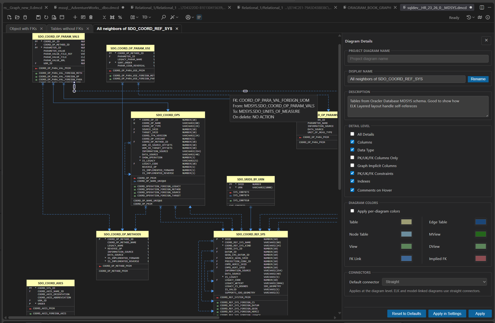
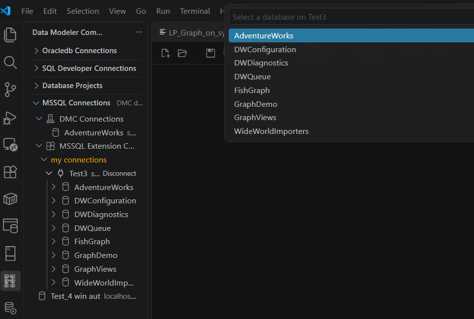
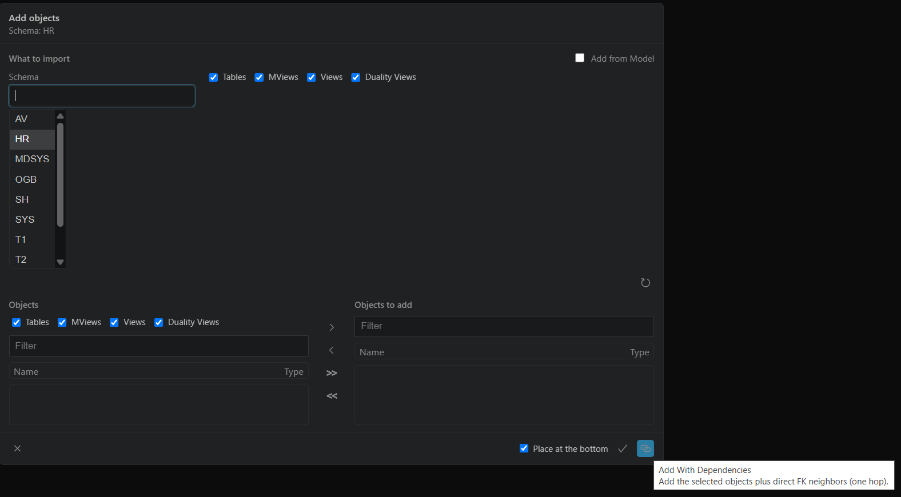
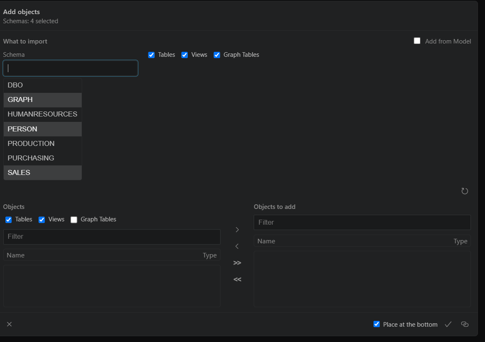
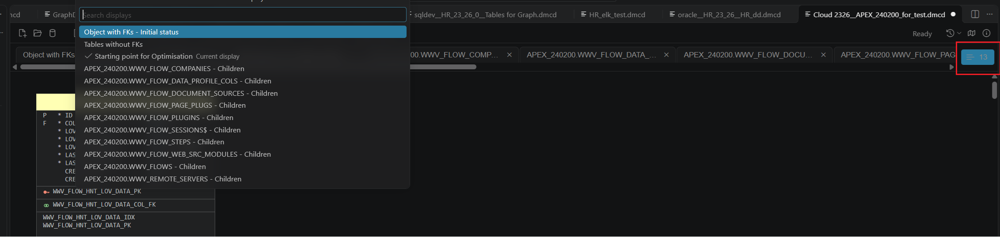
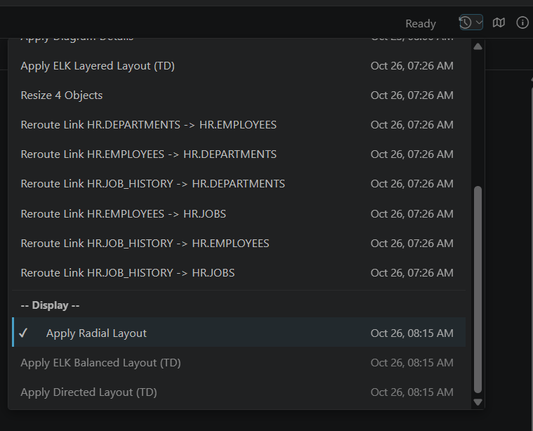
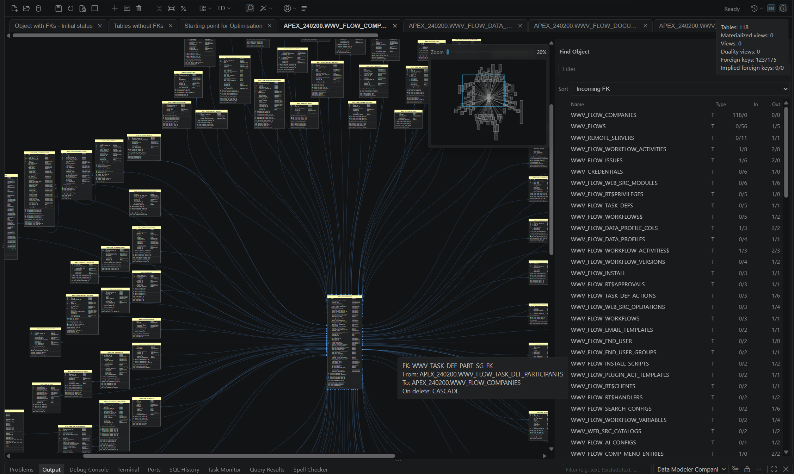
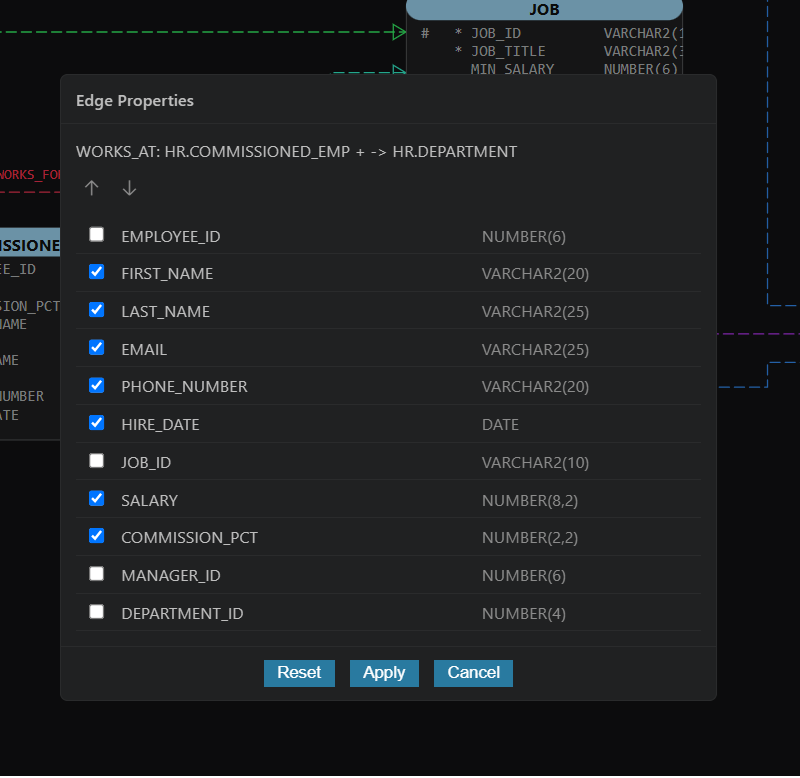
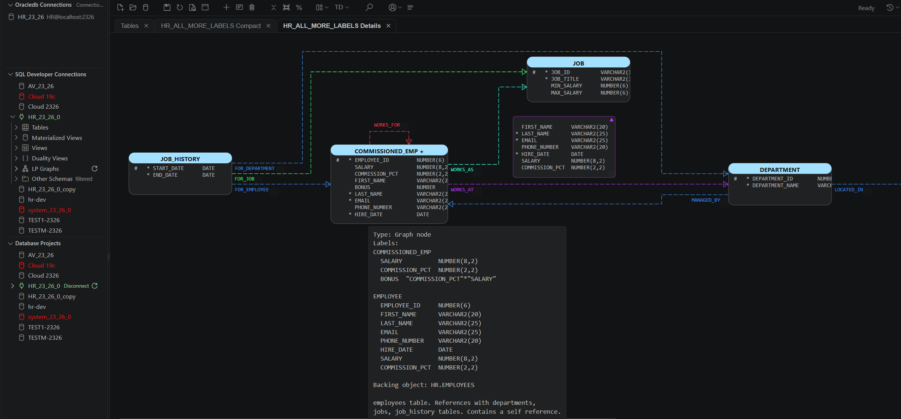
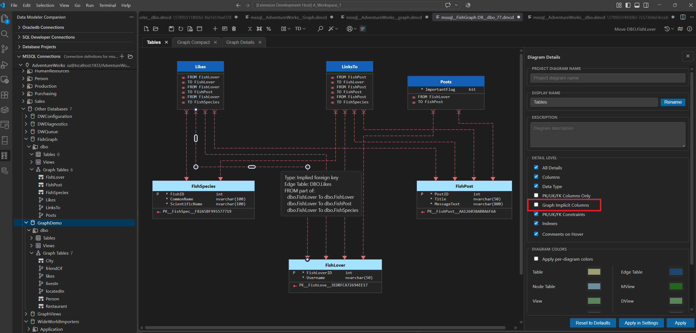

# Diagramming

Data Modeler Companion creates editable database diagrams directly in Visual Studio Code. Save a standalone workspace as a self-contained `.dmcd` file, or keep a model-linked diagram with an imported design as `.dmcmd`.

## Table of contents

- [Create from a database connection](#create-from-a-database-connection)
- ["Add Objects" dialog specifics](#add-objects-dialog-specifics)
	- ["Add Objects" dialog for Free diagrams](#add-objects-dialog-for-free-diagrams)
	- ["Add Objects" dialog for Database project diagrams](#add-objects-dialog-for-database-project-diagrams)
	- ["Add Objects" dialog for Logical and Relational model diagrams](#add-objects-dialog-for-logical-and-relational-model-diagrams)
- [Open stored and file-based diagrams](#open-stored-and-file-based-diagrams)
- [Work on the canvas](#work-on-the-canvas)
	- [Moving and resizing on dense displays](#moving-and-resizing-on-dense-displays)
	- [Quick selection of active display](#quick-selection-of-active-display)
	- [Diagram details drawer](#diagram-details-drawer)
	- [Diagram info](#diagram-info)
	- [Text search](#text-search)
	- [Find Object drawer](#find-object-drawer)
	- [Mini Map](#mini-map)
	- [Diagram context menu](#diagram-context-menu)
	- [Selected Objects context menu](#selected-objects-context-menu)
	- [Undo/Redo History](#undoredo-history)
- [Diagram optimisation](#diagram-optimisation)
	- [Toolbar Optimisation](#toolbar-optimisation)
	- [On object optimisation](#on-object-optimisation)
		- [Optimise with Children](#optimise-with-children)
		- [Optimise with Parents](#optimise-with-parents)
- [Model Diagrams](#model-diagrams)
- [Project Diagrams](#project-diagrams)
- [Property graph diagrams](#property-graph-diagrams)
- [Examples](#examples)

>**Editable relational database diagram with table cards and foreign-key links**  

## Create from a database connection

Use an Oracle Database or Microsoft SQL Server connection tree to **Create Diagram** for connection, schema, object folder, or individual object. Create diagram on connection in fact creates a diagram for connection schema for Oracle Database and for database for SQL Server. If default database is not set then database picker appear to select database or cancel operation.     
**SQL Server Database picker when there is no database set for MSSQL extension connection**

Oracle sources include tables, materialized views, views, duality views, and Label Property Graphs. SQL Server sources include tables, views, node tables, edge tables, and graph relationships.

After diagram is created objects in folder or individual objects can be added to diagram.

From individual objects in the Oracledb, SQL Developer, or MSSQL connection tree, choose **Add to Diagram With Neighbors** to control the foreign-key direction and depth. The matching open diagram stays visible behind the options modal. Select **All**, **Parent**, or **Child**, then a positive **Number of zones** or **All Zones**. One zone is one foreign-key hop from the tree selection; the selected objects are always included. The command supports compatible multi-selections and retains the original tree seeds even if the diagram selection changes. The **Add With Dependencies** one-hop and **ALL Dependencies** shortcuts are also available.  
[Learn about recursive foreign-key expansion](guides/add-all-dependencies.md)

For a more precise scope, open **Add Objects Dialog** and filter by schema, object type, or text. Add the selected objects alone, include direct dependencies, or use the connection-tree command that recursively follows all reachable foreign-key dependencies.

SQL Server view headers list their direct referenced tables and views, alongside any enabled comments. This works with both saved MSSQL connections and shared Microsoft SQL Server extension connections. Local references appear as `schema.object`; cross-database references retain `database.schema.object` (and the server qualifier for linked-server references). References whose type cannot be resolved locally show `undefined`. Referenced objects do not need to be on the diagram for the tooltip to list them.

The connection-tree **Add to Diagram With Dependencies** command imports direct used objects for SQL Server views and Oracle views, materialized views, and JSON relational duality views, alongside the existing one-hop FK neighbors. Oracle supports this through both native Oracle connections and SQL Developer extension connections. Sources can belong to other schemas in the same database and retain their actual object types. The command does not recursively follow nested views, expand FKs of newly discovered view sources, import cross-database/linked-server/DB-link objects, or draw view-to-source relationship lines. Cross-database SQL Server references remain tooltip-only.

In contrast, **Add With Dependencies** inside the **Add Objects** dialog remains FK-only for every provider: used objects in view queries are not added automatically. View dependency tooltips are still populated. Ordinary diagram creation, **ALL Dependencies**, **Add to Diagram With Neighbors**, and **Add From Model** are unchanged; the recursive and neighborhood commands continue to follow foreign keys only.

Dependency extraction uses `sys.sql_expression_dependencies` and is limited by SQL Server metadata visibility. The connection needs appropriate `VIEW DEFINITION` and catalog `SELECT` permissions. A denied dependency query is logged and does not prevent diagram creation or adding the selected objects and available FK neighbors. Missing tooltip entries do not prove that no references exist. Saved `.dmcd` diagrams retain dependency tooltips without reconnecting; existing diagrams need re-extraction/reimport to populate newly available dependency metadata.

## "Add Objects" dialog specifics

There are three kind of diagrams - free diagrams `.dmcd` (free in meaning they contain all required metadata and  it can be reproduced without Database connection ), model diagrams(`.dmcmd`) and project diagrams. Project diagrams are stored in in Oracle Database - using **Save** (**Ctrl+S**) they are saved in database, using **Save As** they can be stored in file system as `.dmcd`file.

### "Add Objects" dialog for Free diagrams

Free diagrams keep dedicated model for objects imported from database inside it content in `.dmcd` file. That model is shared by all displays created on diagram.   
Main source of metadata is database - when dialog is made visible **filtered schemas** for related database connection is shown. After schema is selected and global filters for required object types are set, pressing **Refresh** button will bring database objects in dialog. They again can be filtered by text in filter field and/or by object type allowing certain set of objects to be selected and moved to the right panel. No need objects to be added at once - they can be added in several sessions with Add objects dialog. Objects already presented on diagram do not appear in input list of database objects.   
The right panel (**Objects to add**) has its own text filter. While it is active, selection, **<** and **<<** apply only to the visible objects; hidden objects stay queued and are still added on confirm.   
After objects are selected they can be added on diagram as they are in the list or add with dependencies - adding with dependencies mean tracking of foreign key references from direct children and to direct parent objects (one hop).   
At some point additional displays can be created in order to represent part of bigger picture drawn on main display. No need to add objects from database if they are already in diagram model - in this case **Add From Model** check-box need to be selected.   
There is a variation in **Add Objects** to diagram dialog for **MSSQL Server connection** - more than one schema can be selected before **Refresh** button to be pressed.

**Add Objects** to diagram dialog for **MSSQL Server connection**

### "Add Objects" dialog for Database project diagrams

Project diagram is `.dmcd` diagram extended with project information. For Oracle project diagrams, the project/subproject is the source for objects that can appear on the diagram. If there is a need to show objects external to the project, add those objects from the database to the subproject without adding them to parent projects. SQL Server and Mermaid diagrams can also be stored in projects using **Add Current Diagram**, without adding their objects to Oracle project membership. SQL Server Add Objects continues to use its source database; it never uses the Oracle storage connection as its object source.

Selecting **Add From Model** check-box will show objects already added to diagram and not presented on current display.   

>**Note:** Despite list of objects to add to diagram is taken from project, database dictionary is used to track dependencies when **Add with Dependencies** button is used

### "Add Objects" dialog for Logical and Relational model diagrams

"Add Objects" dialog for model diagrams (`.dmcmd`) uses as source objects in related model. Model diagrams do not support concept of self contained model of objects represented on diagram. In this way any object from the model (supported for diagram visualization) can be added on displays of model diagram.

## Open stored and file-based diagrams

Data Modeler Companion can open or visualize:

- Oracle diagrams stored in Oracle Database through Oracle REST Data Services (ORDS)/Database Actions, or Oracle SQL Developer Data Modeler.
- Mermaid `erDiagram` - text selected in an editor and Mermaid `.mmd` or `.mermaid` files. For editor text (or selected text in editor) use command (`Ctrl+Shift+P`) **Open Mermaid erDiagram**.
- Oracle SQL Developer for VS Code `.dgm` diagram files.

>**Note:** Source `.mmd` or `.mermaid` and  `.dgm` files remain unchanged. Diagrams created from those sources are editable.

[↑ Back to top](#diagramming)

## Work on the canvas

On the canvas you can move and resize objects, edit link routes, change labels location and size for foreign keys and edges, add notes, control visible details and colors, apply layouts, easy navigate with **minimap** or **Find Object** drawer. Objects selection and optimization functionality allow to create and maintain multiple displays in one diagram workspace stored in distributable .dmcd file.  

In both standalone (`.dmcd`) and model (`.dmcmd`) diagrams, click a linked FK name or icon in a table card to select and scroll to its referenced table on the current display. Exported SVG diagrams also support clicking FK links to reveal their referenced tables.

### Moving and resizing on dense displays
On displays with many visible FK links, moving or resizing an object redraws every link around it on each mouse move, which makes the gesture stutter. To keep it smooth, the diagram counts the FK links visible in the viewport when a drag or resize starts. When the count exceeds `dmc.diagram.liveGestureLinkThreshold` (default **100**), a dashed outline follows the mouse instead of the object itself; the object and its links move or resize once when the mouse button is released. Below the threshold objects and links update live, as before. Set the threshold to **0** to always use the outline, or to a very large value to always update live. Either way the gesture is recorded as one undo/redo step.

### Quick selection of active display
For diagrams with several displays, the **All Displays** list button and count stay visible at the right of the scrolling tab strip. It opens VS Code's searchable **Go to Display** picker, with the current display marked. Choose a display to switch to it and bring its tab into view. Switching preserves each display's layout and viewport without adding an undo entry or modifying the diagram; cancelling the picker changes nothing.

**All Displays picker**

### Diagram details drawer
**Diagram Details drawer** can be used to change visible details 
If presentation details are changed in diagram details drawer then **Resize to Visible** functionality can be used to recalculate the size of objects.   
Also type of the line can be changed (smooth or straight) when Directed Graph, Radial or MSAGL layouts are used. Only straight connectors are used for ELK layouts.

Colors for objects type for standalone (`.dmcd`) and project diagrams are defined in extension settings but **Diagram Details drawer** allow easy to change those settings at diagram level or apply them in extension settings.

### Diagram info
The toolbar's **Diagram Info** shows counts of tables, materialized views, views and duality views, shows physical and implied foreign key counts as **visible/hidden**, using the same order as the Find drawer. These totals include self-references but only count links whose two endpoint objects are on the current display.

### Text search

With a diagram focused, press **Ctrl+F** (**Cmd+F** on macOS) to open the compact text-search bar. It contains a search field, the current/total match count, previous/next arrows, and a close button. Search is literal and case-insensitive, with no replace operation. **Enter** goes to the next match, **Shift+Enter** to the previous match, and **Escape** closes the bar. Navigation wraps at either end.

The search field remembers its text while the diagram stays open. Reopening the bar immediately searches the current display again, without requiring you to edit the query. Matches are highlighted, and navigating to an off-screen match scrolls it into view.

This searches rendered SVG diagram text only, not toolbar or drawer text, unrendered model metadata, or inactive displays. Show the relevant diagram details first when searching columns, attributes, data types, or relationship labels that are currently hidden. Search counts refresh when the displayed text changes. Searching does not modify the diagram or its object selection.

### Find Object drawer

Use the toolbar's search button to open **Find Object**. Filter the object list and select an object to select and center it on the diagram. This object-navigation action remains separate from **Ctrl+F** text search. Objects can be sorted by name, incoming or outgoing foreign key links. Clicking on object in dialog will scroll diagram to that object

On first opening a diagram or display, the top-left viewport is kept when an object is visible. If it is empty, the diagram scrolls to the table with the most outgoing physical or implied FK links shown on that display. Ties use the topmost, then leftmost table; without tables, the topmost object is used. This preserves the opening zoom and selection and does not modify the diagram. Returning to a visited display restores its previous viewport, even if that area is empty.

### Mini Map

Use the toolbar's **Minimap** button to show a compact overview of the current display. The outlined rectangle marks the area visible on the main canvas, helping you keep your bearings when a diagram is larger than the screen.

Click a location in the minimap to center the canvas there, or drag across it to move around the diagram. Use its **Zoom** slider to change the main canvas zoom. The overview follows changes to the diagram and viewport; click **Minimap** again to hide it. Navigation does not move objects or change the selection.

### Diagram context menu

Right-click an empty area of the canvas to open actions for the current display. Use **Layout** and **Layout Direction** to rearrange objects, **Diagram Details** to choose visible information, and **Resize to Visible** to fit cards to their displayed content. For relational diagrams, **Show Owner** controls schema names in object headers.

Choose **Create Note** to add an annotation at the clicked location. **Create Display (from Current Diagram)** creates another tab in the same workspace, while **Create Diagram (from Current Diagram)** opens a separate unsaved diagram based on the current view. The **Optimise** submenu provides the [diagram optimisation](#diagram-optimisation) commands for splitting dense or isolated groups into focused views.

Additional actions depend on the diagram: graph displays can offer edge colors, model diagrams can offer remote-object refresh, and supported objects can offer **Show Create Script (All Objects)** or **Show Definition (All Objects)**. Only applicable actions are shown.

### Selected Objects context menu

Select the objects you want to work with, then right-click an object to open the object context menu. **Create Display from Selected** puts the selection on a new tab in the same workspace; **Create Diagram from Selected** opens it in a separate unsaved diagram. These commands leave the source display unchanged, making them useful for preparing a focused view of a larger model.

Use **Select Neighbors** to extend the selection through parent or child foreign-key relationships already on the display, choosing the direction and number of zones. For example, select a table, include its direct children, then choose **Create Display from Selected** to keep an overview and a focused view side by side.

**Selected Object Colors** changes colors for the selected objects, and **Reset Selected Colors** removes their overrides. **Show Create Script** and **Show Definition** are available where supported. **Optimise with Children** and **Optimise with Parents** instead focus on the right-clicked table and can also declutter the source; see [on-object optimisation](#on-object-optimisation) for their different behavior.

For logical relationship attributes, use the relationship's **Line Format** dialog to change its box color. This color stays the same when switching themes, while text contrast adapts automatically. **Selected Object Colors** and **Reset Selected Colors** do not change relationship attribute colors; diagram-wide defaults remain available in **Diagram Details**.

### Undo/Redo History

All operations on diagram starting with its initial state, add, remove, resize of objects, create and remove displays, applying layouts, changing details on diagram are included in that history. Using history status of diagram can be changed to any point in that history back or forward.

The first seven operations show only labels to keep the list compact. On reaching eight, timestamps appear for all recorded operations, including earlier ones.

The count includes both undoable and redoable entries. Initial state does not count and never has a timestamp. Times use local date/time format, showing month, day, hour, and minute. 

[↑ Back to top](#diagramming)

## Diagram optimisation
The purpose of diagram optimisation is to minimize number of objects and especially number of FK links on diagram. It can be driven manually and one of optimisation processing [**Optimise with Children**](#optimise-with-children) or [**Optimise with parents**](#optimise-with-parents)  can be applied for tables of interest.   
Diagram optimisation even can start when creating a new diagram from a database schema or object folder - if `dmc.dmcd.autoSplitDatabaseImportDisplays` option in extension settings is set to true then objects will be split into three initial displays `Object with FKs`, `Tables without FKs`, and `Views without FKs`. That processing does not apply to single-object imports and Add Objects to Diagram flows.  

### Toolbar Optimisation

The toolbar's **Optimise** menu separates dense incoming FK groups into focused displays within the same diagram workspace. **Optimize Diagram** creates one display per qualifying parent, named **<parent_name> - Children**, and applies **Radial** layout with that parent at the centre.   
A parent qualifies when it has at least the configured number of distinct child objects connected by non-hidden FKs on the source display. The default is **8**, controlled by `dmc.diagram.optimizeChildrenThreshold`. Multiple FKs or graphical synonyms of the same child count once; self-references and off-display objects do not count. 

Each display uses [**Optimise with Children**](#optimise-with-children) processing: it includes the parent and all its direct children already on the source, reveals their focused incoming FKs even if previously hidden, and hides unrelated connections without deleting FK metadata. Shared children appear independently in every applicable display; this does not create additional graphical synonyms within a display. The source display remains active and its surviving cards retain their positions.

Children connected only to their parent are removed from the source display. Children with other relationships remain, but their processed incoming links to qualifying parents are hidden. Qualifying parents remain as overview anchors, including those that are also another parent's children. Existing displays, isolated objects, notes, and database objects are unchanged. The entire operation, including the generated displays and Radial layouts, is **one undo/redo step**.

**Example for generated Display with optimisation for children**

Multiple displays are created - **Diagram Info** shows foreign key counts as **visible/hidden**, in way similar to Find drawer. These counts include only FK links that really can exist on diagram (child and parent tables are both on display).

**Optimize Isolated** : it moves objects without FK links into a separate unsaved **Isolated Objects** diagram. A self-reference FK prevents an object from being isolated.

### On object optimisation

#### Optimise with Children

Right-click a table and choose **Optimise with Children** to separate its incoming foreign-key relationships into a focused diagram or display. The target contains the focused table and its distinct direct children already present in the source, not grandchildren or unrelated referenced tables. Several FKs from one child do not add duplicate table cards.

The target shows incoming FKs to the focused table, including ones hidden in the source. The focused table's self-FKs are included, and child-table self-FKs retain their existing visibility. Links between different children, reverse links from the focus to a child, and other unrelated connections are hidden. Hiding lines does not delete FK metadata or change the database.

Choose **Show in New Display** for another tab in the same workspace, or **Extract to New Diagram** for a separate unsaved diagram. The corresponding **Last** choices reuse the previous destination. Children connected only to the focus are removed from the source display; children connected to other tables remain there too. The focus stays in the source. Display targets retain the included objects' relative positions, and link visibility is saved per display.

Unlike **Select Neighbors** with **Child** and one zone followed by **Create Display from Selected**, optimisation also declutters the source and hides unrelated connections in the target. Creating a display from a selection leaves the source unchanged and retains links between the selected tables.

#### Optimise with Parents

Right-click a table and choose **Optimise with Parents** to create a focused diagram or display containing that table and its direct parents already present in the source. Only the selected table's FKs to its parents and self-references on included tables are shown. Links between different parent tables, reverse links to the selected table, and other unrelated connections are hidden without deleting their FK metadata. Focused FKs are shown even if hidden in the source.

The **New** and **Last** destination choices work as for children optimisation. The selected table is removed from the source display; its parents remain. Display targets preserve relative object positions and save their link visibility independently.

[↑ Back to top](#diagramming)

## Model Diagrams
Logical model diagrams display entity and entity-view names without schema or owner prefixes. Owner visibility is always **Never**, and **Show Owner** is omitted from the toolbar and canvas context menu. Relational diagrams retain their owner visibility settings.

For logical and relational model diagrams, **Create Diagram (from Current Diagram)** opens an independent, unsaved model-linked editor with the current display's layout. First save and the diagram's **Save As** ask only for a name and store the `.dmcmd` file in the owning model's `diagrams` folder. Cancelling keeps the diagram modified.

[↑ Back to top](#diagramming)

## Project Diagrams
**Add Current Diagram** can store SQL Server and Mermaid-origin DMCD snapshots in an Oracle-backed project or subproject. Both remain blocked for **Add Current Diagram With Objects**. Oracle diagrams still require the target project's SQL Developer connection; native OracleDB diagrams remain blocked. See [project diagram storage and schema requirements](database-projects.md#add-current-diagram).

For a Database Project diagram, click the info button beside **Project Diagram Name** in **Diagram Details** to see its connection, top-level project, and subproject path. If the SQL Developer connection is disconnected, this request offers to connect before reading the project names. Opening this read-only information does not modify the diagram. When project names are unavailable or the connection prompt is cancelled, the project ID is shown instead; close and reopen the popover to retry.

**Ctrl+S** saves a new database revision of a project diagram even without local edits. If another revision was stored since loading or saving, the conflict warning identifies the diagram, connection, and project path and offers **Overwrite**, **Retry**, or **Revert**.

Project information, saves, and refreshes use the Oracle project storage connection, not the SQL Server source connection. SQL Server diagrams retain their source database/catalog and identifiers; Mermaid diagrams retain vendorless provenance after saving and reopening. Double-click on SQL Server or Mermaid objects does not open SQL Developer details. Note editing and diagram-view navigation are unchanged. Project transfer remaps schemas only for Oracle diagrams; non-Oracle snapshots retain their source metadata and contents apart from new project ownership.

[↑ Back to top](#diagramming)

## Property graph diagrams

Oracle Label Property Graphs and SQL Server graph tables have graph-oriented displays alongside their relational table views. Graph displays expose vertices or nodes, edges, properties, labels, comments, and their underlying physical objects.

In SQL Server table displays, **Diagram Info** counts **Node Tables** and **Edge Tables** separately from **Tables**. Both categories appear when the active display contains either kind, including a zero for the absent kind. They are hidden when neither is present and are not added to Graph Compact or Graph Details displays.

SQL Server diagrams omit **Materialized views** and **Duality views** from Diagram Info because those object types are not supported by SQL Server.

On Oracle 23+, schema imports and Tables, Views, and Materialized Views folder imports can annotate directly referenced graph backing objects with vertex, edge, or combined roles. The **Check Oracle Property Graph Table Usage** setting controls this lookup. These ordinary imports do not resolve synonyms or add graph-derived implied foreign keys.

Opening or adding an Oracle Label Property Graph imports its actual backing tables, views, and materialized views. If a direct backing object is unavailable, local synonym chains are resolved with private-synonym precedence and PUBLIC fallback. Database-link targets are not followed. Graph tooltips show the actual backing object and kind, and the original reference and synonym path when applicable.

Double-click an Oracle graph node to open its resolved backing table, view, or materialized view in SQL Developer. For an Oracle graph edge, right-click its line or property box and choose **Open Backing Object Details**; this action is also available for edges without properties. Navigation uses the backing object's identity, not the displayed graph label, graph element name, or synonym reference. If needed, select a SQL Developer connection; this association is reused for the panel session without changing the diagram's Oracle connection. Older saved diagrams recover backing targets from saved model identities and types when the match is unambiguous. Missing or ambiguous targets produce a standard VS Code warning, and failed opens produce a standard VS Code error notification. Canceling connection selection is silent.

The graph's source/destination column mappings produce implied foreign keys in its relational display even when physical PK/FK constraints are absent. Equivalent existing foreign keys are not duplicated, and graph keys do not create physical primary-key constraints. Unresolved backing references produce one consolidated warning; their graph elements remain visible with resolution details, but unavailable physical objects and links to them are omitted. If every backing reference is unresolved, the graph opens on a graph display with an empty Tables tab. Tooltip provenance and resolution details are retained after property reordering and save/reopen.

Right-click an edge line or its property box and choose **Edge Properties...**. Select rows with Ctrl/Cmd-click or Shift-click, then move the selection with the shared Up/Down controls or Alt+Up/Down. Visibility checkboxes are independent of row selection. **Apply** saves the choices for that connection in the current tab; other connections from the same edge table and other tabs are unchanged. **Reset** restores the imported order and makes all properties visible when applied. **Cancel** discards the draft.  

**Edge properties dialog**

Hidden properties remain available in hover tooltips, which follow the chosen property order. Oracle tooltips retain their label groups and expressions. A top-right triangle indicates hidden properties; its tooltip includes the hidden count and complete property list. Hiding every property leaves a movable, marker-only box. Its expanded size is preserved for showing properties again, including after save/reopen. The diagram-wide **Edge Properties** switch still controls overall box visibility. Changes support undo/redo without rerouting the edge.

**Edge properties with hidden properties**

> **SQL Server node and edge tables displayed with Implied FKs for connections between nodes**  

## Examples

The [example catalogue](../examples/README.md) describes the sample diagram payloads included in this repository.

[↑ Back to top](#diagramming)