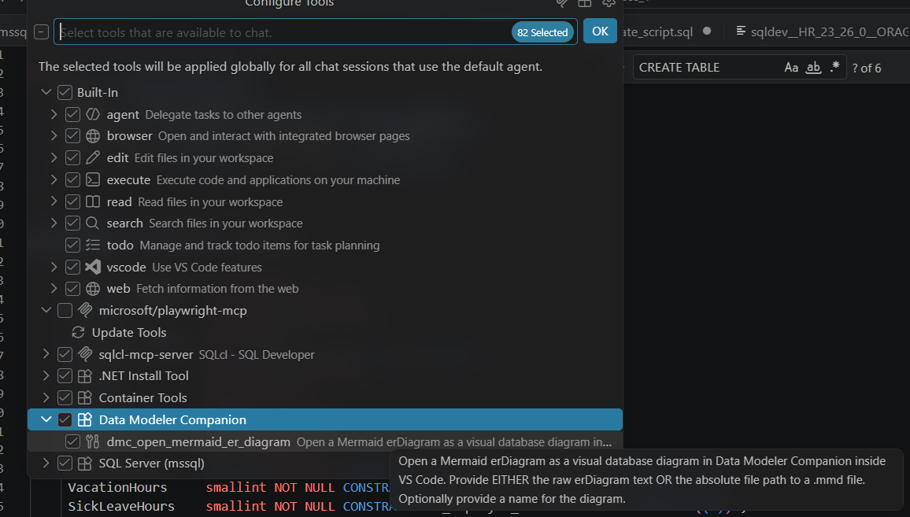

# Mermaid ER Diagram Tool Architecture

## Overview

The extension provides two independent paths for opening Mermaid `erDiagram` content as a visual database diagram in Data Modeler Companion. Each path targets a different client type.

---

## 1. In-Process Language Model Tool (VS Code Copilot)


**Tool name:** `dmc_open_mermaid_er_diagram`

**How it works:**

1. Copilot(or another AI assistant) invokes the tool with `{ text?, path?, name? }`.
2. The handler reads file content if `path` is provided, otherwise uses `text` directly.
3. Validates that the content contains an `erDiagram` block.
4. Calls `dmc.openMermaidErDiagram` command to open the diagram in the custom editor.
5. Returns a `LanguageModelToolResult` confirming success.

>**Note:** There is no explicit mapping between FK columns and relationships defined on tables. DMC will try to map them based on named but it's possible to fail on that.

**Advantages:**
- Runs entirely in-process — no child process, no temp files, no deep-link chain.
- Immediate, reliable execution within the extension host.

**Requirements:**
- VS Code ≥ 1.99 (when `vscode.lm.registerTool` was introduced).

**DMC open mermaid erDiagram tool should appear in list of tools**


---

## 2. Stdio MCP Server (External MCP Clients)

**Script:** `out/mcp/mermaidErMcpServer.js`

**Tool name:** `open_mermaid_er_diagram` (MCP protocol tool name)

**How it works:**

1. An external MCP client connects to the server via stdio transport.
2. The client calls `open_mermaid_er_diagram` with `{ text?, path?, name? }`.
3. The server normalises input, writes content to a temp `.mmd` file.
4. Builds a `vscode://` URI targeting the extension's URI handler.
5. Launches the URI via the platform-specific command:
   | OS      | Command                                      |
   |---------|----------------------------------------------|
   | Windows | `rundll32 url.dll,FileProtocolHandler <uri>`  |
   | macOS   | `open <uri>`                                  |
   | Linux   | `xdg-open <uri>`                              |
6. VS Code's URI handler receives the request and opens the diagram.

**Configuration for external clients:**

The server requires two environment variables to construct the `vscode://` deep-link URI:
- `DMC_EXTENSION_ID` — the extension identifier (publisher + name)
- `DMC_URI_HANDLER_PATH` — the URI handler route within the extension

For Claude Desktop, Cursor, or other MCP-compatible clients, add this to their MCP settings:

```json
{
  "mcpServers": {
    "dmc-mermaid-er": {
      "command": "node",
      "args": ["C:/Users/<user>/.vscode/extensions/philip-stoyanov.data-modeler-companion-projects-0.0.1/out/mcp/mermaidErMcpServer.js"],
      "env": {
        "DMC_EXTENSION_ID": "philip-stoyanov.data-modeler-companion-projects",
        "DMC_URI_HANDLER_PATH": "openMermaidErDiagram"
      }
    }
  }
}
```

Replace `<user>` and the version number with the actual values for your installation.

**Limitations:**
- Fire-and-forget: the platform launcher (`rundll32`, `open`, `xdg-open`) does not report whether VS Code actually handled the URI.
- Timing-sensitive: the server closes the transport shortly after launching the URI.
- Requires VS Code to be running and the extension to be activated.


## Example prompt for AI assistant

There is no support for **not null** constraints in Mermaid erDiagram. DMC parser support declaration of not null constraint provided as starting NN string in comments. If you want that and also usage of FK constraint names follow following pattern when ask you AI assistant to generate Mermaid erDiagram for your database schema:

```markdown
Get metadata for all tables in HR schema and create Mermaid erDiagram definition follow Mermaid rules for presenting data type (first) and column name (second). Include PK, UK and FK constraints and related column status. Use foreign key constraint name as relationship-label name/role.   
Also put not null status for columns as comment containing "NN" - comments are surrounded in double quotes.  
For column data type also include length for character types or precision and scale for numeric types.  
Use full form of table name in form "schema.table_name" surrounded in double quotes - example "HR.JOBS".  
Send that definition to mcp tool dmc_open_mermaid_er_diagram for such Mermaid erDiagram diagrams to render it - include also data and time in file name.   
```

Last sentence can be replaced with following one:
```markdown
Create editor in VS Code and past definition there and save it in file in Documents folder.
```
 
