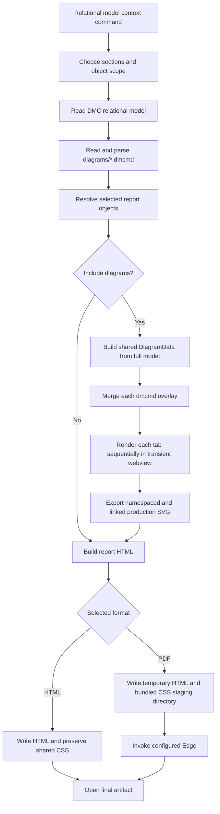

# Tables Report Workflow

## Overview

The tables report is generated from a relational DMC model tree node as either interactive HTML or an A4 PDF. It can include selected model metadata and production-quality SVG renderings of persisted model-linked diagrams.

The workflow is split between two environments:

- The VS Code extension host selects the report scope, reads model files, reconstructs diagrams, generates HTML, and writes the selected artifact.
- A transient webview renders each diagram tab with the normal JointJS runtime because production card layout and SVG serialization require a browser DOM.
- For PDF output, the extension invokes a user-configured Microsoft Edge installation in headless mode. Edge is free, but it is installed separately and is not bundled by this extension.

The command is `dmc.designs.generateTablesReport`. It is available from the context menu of a relational model node (`dmc.designModel`).

## User Workflow

1. Run **Generate Tables Report** on a relational model node.
2. Configure the report in the tabbed dialog:
	- Set the Reports folder, report title, and report file name.
	- Select HTML or PDF when `dmc.reports.edgeExecutablePath` is configured. Without that setting, the existing HTML-only workflow is shown.
	- For PDF, choose whether each object starts on a new page. This is enabled by default.
	- On **Templates**, optionally select an applicable SDDM report template and refine its section checkboxes. Dynamic properties remains a DMC-only section.
	- On **Objects**, optionally apply an SDDM report configuration to set the object and diagram selections. Use **All selected**, **All deselected**, or **Objects in selected diagrams** to update the object selection, then refine object and diagram checkboxes individually.
3. When the Reports folder is empty both in the dialog and in `dmc.reports.folder`, choose a folder from the native picker. The chosen folder is saved in that setting.
4. The extension writes one uniquely named artifact directly in the Reports folder, for example `<model-name>_tables.html`, `<model-name>_tables.pdf`, or a collision-safe `_1` variant. The selected format controls the extension even when another extension was entered.
5. HTML uses a content-addressed default stylesheet named `tables-report.<sha256>.css` and optionally loads `tables-report.custom.css` after it. PDF generation stages the exact `tables-report.html` and matching content-addressed bundled stylesheet in a random temporary directory under the Reports folder, then removes the directory after success or failure. Edge uses an isolated profile in the OS user temporary directory and falls back to the report staging directory when OS temporary storage is unavailable.
6. The generated report is opened with the system's default application.

Cancelling any picker stops generation without writing a report.

## PDF Setup and Layout

Set the machine-scoped `dmc.reports.edgeExecutablePath` setting to the absolute path of the Microsoft Edge executable. The path is the PDF feature flag; the extension does not search the system or `PATH` for Edge.

Common paths are:

```text
Windows: C:\Program Files (x86)\Microsoft\Edge\Application\msedge.exe
macOS:   /Applications/Microsoft Edge.app/Contents/MacOS/Microsoft Edge
Linux:   /usr/bin/microsoft-edge or /usr/bin/microsoft-edge-stable
```

The configured file must have a supported Edge executable name and, on macOS and Linux, execute permission. PDF generation fails with an actionable message when the path is invalid, Edge exits unsuccessfully, times out, or does not create a non-empty file. It does not silently fall back to HTML.

PDF output uses A4 pages. The report compares the contain scale available in portrait and landscape and uses the orientation that renders the diagram larger; portrait wins an exact tie. Each diagram is enlarged or reduced by the limiting page width or the height remaining below its title, whichever produces the smaller scale, so it uses as much printable space as possible while preserving its aspect ratio. Report authors remain responsible for selecting or arranging diagrams that are readable at A4 size. Every diagram starts on a new page with its title. The table of contents is printed first and its links remain clickable; only the interactive filter is hidden. PDF outline bookmarks depend on the installed Edge version and are not guaranteed.

## End-to-End Flow



## Model and Diagram Loading

The command handler in `src/extension.ts` reads the relational model with `readDmcModel(node.modelPath)`.

Persisted diagrams are discovered in `<modelPath>/diagrams`. Every regular file ending in `.dmcmd` is parsed with `parseDmcmdFile`. Invalid diagram files are skipped, recorded, and reported through the extension log instead of aborting the whole report.

Object selection uses stable model IDs where available. **Objects in selected diagrams** is an immediate selection action and keeps a normalized `SCHEMA.NAME` fallback so older diagram items without stable IDs can still resolve to model objects.

Checked object rows control report articles. Checked diagram rows control diagram tabs rendered in the report. An SDDM report configuration applies both checkbox sets exactly; a configuration with no diagram IDs selects no diagrams. Object and diagram selections can always be refined manually after applying a configuration or selection action.

## Production Diagram Rendering

Diagram rendering uses the same model conversion, overlay restore, JointJS cards, links, routing, colors, labels, and tooltips as the interactive editor.

For each persisted diagram:

1. `dmcModelToDiagramData` converts the full relational model using the design's `dl_settings.xml` preferences.
2. `applyModelLinkedOverlay` applies the `.dmcmd` workspace, tabs, placements, geometry, and presentation state.
3. `DmcDiagramPanel.restoreDiagramFromPersistedStorageFile` restores one active tab into renderable `DiagramData`.
4. `ReportDiagramRenderService` sends a correlated `renderReportSvg` request to a transient webview.
5. The webview calls the normal `renderDiagram` path.
6. Rendering waits eight animation frames for deferred card DOM updates.
7. Links are rerouted and their layer order is enforced.
8. `buildExportSvgString` clones and serializes the live paper SVG.
9. The webview replies with `reportSvgRendered`, carrying either SVG text or a localized error.

Tabs are rendered sequentially. This avoids overlapping mutations of the single graph and paper owned by the transient webview. Each request has a unique request ID and a 30-second default timeout.

The render service is disposed in a `finally` block. Disposal resolves pending requests with an error and closes the transient panel.

## SVG Export Rules

`src/diagram/runtime/export.ts` prepares each cloned SVG for use outside VS Code:

- Computes a stable content `viewBox` and pixel size.
- Removes live paper pan and zoom transforms.
- Keeps relevant font, color, `--erd-*`, and `--vscode-*` style values.
- Bakes selected VS Code theme variables into the SVG root.
- Adds native SVG `<title>` elements for exported tooltips.
- Prefixes internal IDs for each report tab to prevent collisions between multiple inline SVGs.

ID namespacing updates internal SVG references such as markers, masks, filters, clip paths, and accessibility references. Report links and object targets are added after namespacing, so external article fragments such as `#table-<encoded-id>` are not rewritten.

These report-specific changes are made only on the cloned SVG. They do not alter the live diagram or normal editor behavior.

## Bidirectional Navigation

### Report Content to Diagrams

Each object article has a stable anchor:

```text
table-<encodeURIComponent(object-id)>
```

If an object has no ID, its article falls back to the encoded qualified name. The **Used In Diagrams** section links from an object article to each persisted diagram tab containing that object.

When an object has a stable ID and its diagram tab has rendered content, each Used In link targets the canonical table or materialized-view card within that inline SVG:

```text
diagram-object-<encodeURIComponent(JSON.stringify([object-id, diagram-id, "tab:<tab-id>"]))>
```

If a tab has no stable ID, `index:<zero-based-tab-index>` is used instead. Encoding the complete tuple prevents collisions between diagram, tab, and object IDs. Multi-tab diagrams include the tab name in their Used In labels. When an object appears multiple times in one tab, the first persisted placement is the canonical target; duplicate placements do not create duplicate links or HTML IDs. A failed tab render or an object without a stable ID falls back to the diagram-tab section anchor.

Diagram tab sections use anchors based on the diagram file ID and tab ID:

```text
diagram-<encodeURIComponent(diagram-id + "-" + tab-id)>
```

Foreign-key references in report content link to target/source articles when the referenced object is included in the report.

### Diagrams to Report Content

Production table and view card roots expose their stable identity as `data-erd-*` SVG attributes. During report export:

1. `buildTablesReportObjectAnchors` creates an object-ID-to-article-anchor map from only the selected report objects.
2. The article-anchor map and a per-tab object-target map travel through `ReportDiagramRenderService`, `runtime/messages.ts`, and `webviewRuntime.ts`.
3. `annotateReportObjectLinks` finds cloned card roots by `data-erd-object-id`.
4. For mapped objects, it overlays the card header geometry with a transparent SVG `<a>` hit area.
5. Clicking the table or view header navigates to the matching object article.

The cloned header link also receives the object-specific target ID used by Used In navigation. Only the first matching card for an object in a tab receives that ID. The pre-existing name-based card root ID remains unchanged so foreign-key links within the exported SVG continue to work.

Stable UUIDs are authoritative. Names are not used to add production SVG header links, which avoids ambiguous navigation when names collide or change. Objects without a mapped UUID remain unlinked.

Diagram View cards use the same report-only SVG annotation path. `buildTablesReportDiagramViewAnchors` maps each unique root or display tab UUID from the selected relational model diagrams to its diagram-tab section anchor. `annotateReportDiagramViewLinks` overlays mapped Diagram View cards with a transparent SVG link to that section. The generated HTML and Edge-printed PDF therefore share the same fragment navigation.

Only diagrams included in the report are link targets. Diagram Views that point to another model, an excluded or unresolved diagram, or an ambiguous duplicate tab UUID retain their rendered card or composite preview but remain unlinked. A target tab that failed to render remains linkable because its report error section still has a stable anchor.

## HTML Generation

`buildTablesReportHtml` in `src/dmc/report/tablesReport.ts` is a pure HTML generator. It:

- Sorts objects by qualified display name.
- Groups sidebar navigation by schema.
- Builds incoming foreign-key lookup data.
- Resolves diagram placements for **Used In Diagrams** links.
- Emits only the sections enabled by the user.
- Renders Columns as `No`, `Column Name`, `Keys`, `M`, `Data Type`, `Domain Name`, `Formula (Default Value)`, and `Security`.
- Formats Keys as `P`, `U`, or blank, with `F` appended for foreign-key participation. Primary-key participation takes precedence over unique-key participation.
- Uses `formulaDesc` for computed columns and `defaultValue` for regular columns.
- Resolves domain IDs through the design domain catalog, falling back to the stored domain value when unresolved.
- Formats Security from the present `PII`, `Sensitive`, and masking-type values, joined with ` / `.
- Emits a separate Columns Comments table containing only columns with a description or notes. Description uses `comment` first and falls back to `commentInRDBMS`; Notes uses `notes`.
- Embeds production SVG directly into each diagram tab section.
- Escapes model text before inserting it into HTML.
- Adds a small client-side filter for sidebar object names.

The **Columns** and **Comments and notes** selections are independent. The latter controls table comments and Columns Comments, so descriptive metadata can be generated without the main Columns table.

If production SVG was requested but one tab failed to render, that tab receives a `.diagram-error` message. Other tabs and the rest of the report are still generated.

The simplified SVG renderer in `renderDiagram` remains a fallback for callers that provide parsed overlays without `renderedTabs`. The extension command normally supplies production-rendered tabs when diagrams are enabled.

## Output and CSS Evolution

The output directory is the configured `dmc.reports.folder` (or the folder chosen for the current report). A model-derived subdirectory is not created. The extension reserves a unique report name instead of overwriting an existing report:

```text
<reports-folder>/<sanitized-model-name>_tables.html
<reports-folder>/<sanitized-model-name>_tables_1.html
<reports-folder>/<sanitized-model-name>_tables.pdf
<reports-folder>/<sanitized-model-name>_tables_1.pdf
```

The folder contains one or more extension-owned default stylesheets:

```text
tables-report.<sha256>.css
```

The extension calculates the filename from the exact bytes in `media/reports/tables-report.css`. Unchanged CSS reuses the existing asset. Changed CSS produces a new filename, so new reports automatically receive updated defaults while existing reports continue to resolve their original stylesheet. A missing or modified hash-named asset is restored from the matching bundled bytes during generation.

Hash-named stylesheets are immutable extension assets and are not automatically removed because older HTML reports may reference them. The extension also leaves a legacy `tables-report.css` untouched for reports generated by earlier versions, but newly generated reports do not reference it.

For customer HTML customization, users create an optional `tables-report.custom.css` in the Reports folder. New HTML reports include it after the versioned default stylesheet when it exists, so its rules override defaults without preventing future default upgrades. Existing edits to legacy `tables-report.css` are not automatically treated as overrides because that file may contain obsolete copies of every default rule.

PDF does not use report-folder custom CSS. It stages the generated HTML beside the matching content-addressed bundled stylesheet, invokes Edge with an isolated temporary profile, and removes both staging and profile directories after success or failure. This makes PDF output deterministic and leaves only the final PDF in the Reports folder.

## Failure Handling

- Invalid `.dmcmd` files are skipped and logged.
- A webview startup timeout returns a renderer startup error.
- A per-tab render timeout produces an error for that tab.
- Closing or disposing the renderer resolves pending requests with an error.
- A failed `postMessage` is converted into a render result error.
- A tab with no exportable content receives a localized diagram error.
- Used In links for a failed tab target that tab's diagram-error section instead of a missing card target.
- Model loading or output-writing failures abort generation and show a VS Code error notification.
- Invalid Edge configuration, Edge process failure, timeout, and missing or empty PDF output abort PDF generation without HTML fallback.

Skipped files and failed tabs are summarized after generation; details are written to the extension log.


## Validation

Run the focused report tests after changing HTML, anchors, or SVG annotation:

```powershell
npm run compile
node --test test/exportSvg.test.cjs test/tablesReportHtml.test.cjs
```

Run lint when changing the TypeScript workflow:

```powershell
npm run lint
```
