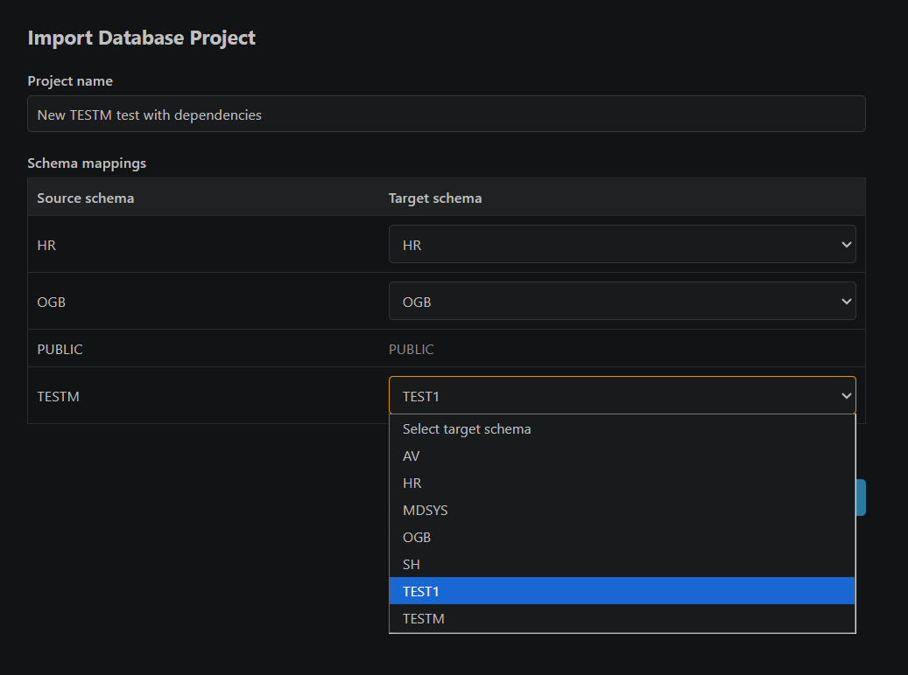

# Database Projects: Transfer and SQLcl Generation

Database Projects can be transferred between Oracle SQL Developer for VS Code connections and used to generate focused SQLcl resources.

## Export a project bundle

1. Select a project in **Database Projects**.
2. Run **Export Project...**.
3. Choose the destination `.dmcproj` file.

The bundle contains the selected project, its descendant subprojects, their typed object selections, and valid project diagrams. A diagram with empty or invalid content is skipped without preventing the remaining hierarchy and valid diagrams from being exported.

## Import a project bundle

1. Select a connected SQL Developer connection in **Database Projects**.
2. Run **Import Project...** and choose a `.dmcproj` bundle.
3. Enter the imported root project name.
4. Keep the source schemas or map each source schema to a schema available in the target connection.

Import creates a new project hierarchy and new target identities. Schema mapping updates Oracle project object ownership and schema-bearing references inside Oracle diagrams, then associates those diagrams with the selected target connection.

SQL Server and Mermaid diagrams retain their source metadata, schemas, model, and layouts without remapping. Only project ownership and storage connection change; **Ctrl+S** saves to the imported project. Bundles containing no Oracle project objects require no schema mappings. Non-Oracle diagram objects are not included in project verification or SQLcl generation.

**DB Project Import dialog with schema mapping**

Invalid or missing diagram entries are skipped while the project hierarchy and other valid diagrams continue importing. If a database write fails partway through import, records already created remain in the target connection and the reported count identifies the partial result.

## Generate a SQLcl project filter

1. Select a project or subproject.
2. Run **Generate SQLcl Project Filter**.
3. Save the suggested `DMC_<project-name>.filters` file.

The filter contains objects assigned directly to the selected scope. Objects assigned only to descendant subprojects are not included. Entries are grouped by owner and object type for use with SQLcl's `project export` command.

SQLcl project filters exclude all `SYS`-owned objects, including directories and referenced domains. These objects remain in project membership and portable `.dmcproj` bundles. No filter output is generated when a project contains only `SYS` objects. DDL generation scripts have a directory-only exception described below; other `SYS` objects remain excluded there as well.

Analytic views and property graphs are excluded by default because support depends on the installed SQLcl version. Enable their Database Projects filter settings only when that SQLcl installation supports them. Assertions are always excluded for now.

## Generate a SQLcl DDL generation script

1. Select a project or subproject.
2. Run **Generate SQLcl DDL Generation Script**.
3. Save the suggested `DMC_<project-name>.sql` file.
4. Run the generated script with SQLcl.

The script processes objects assigned directly to the selected project or subproject. It creates owner and object-type directories and writes one DDL output per object. Database Projects settings control the SQLcl starting directory, output root name, package file extensions, and whether package specifications and bodies share one file.

Generated folder and file-name components replace invalid filesystem characters and SQLcl substitution ampersands with underscores. Trailing dots/spaces are replaced, and Windows reserved names receive an underscore prefix. For example, the directory identifier `C:\temp` exports to `SYS/directories/C_temp.sql`; its lookup name and returned DDL remain unchanged. These rules also apply to owner folders, the output root name, and other object filenames, but not the configured starting path. Directory filenames are compared case-insensitively and receive numeric suffixes (`_2`, `_3`, and so on) when needed to avoid overwriting another directory export, including on Windows. Suffixes skip filenames already used by other directory names. Generation still reports an error for other objects if distinct references sanitize to the same output path. Platform-specific path-length limits and case sensitivity for other object types still apply.

The preamble enables `SET TRIMSPOOL ON` to remove SQLcl's trailing-space padding from spooled lines while preserving leading indentation.

The initial settings include `SET FEEDBACK OFF` and `SET HEADING OFF` to suppress row-count messages and column headings. 

Supported SQLcl DDL paths cover tables, views, materialized views, duality views, domains, relational dimensions, sequences, triggers, procedures, functions, synonyms, directories, packages, property graphs, and analytic views. Domains, relational dimensions, and property graphs use Oracle metadata extraction rather than SQLcl's `ddl` command. Domains require a domain-capable Oracle database (23ai or later) and are written to `<owner>/domains/<name>.sql` using `SYS.DBMS_METADATA.GET_DDL('SQL_DOMAIN', ...)`. The `SQL_DOMAIN` metadata token preserves compatibility with earlier domain-capable releases; newer Oracle releases deprecate it in favor of `DOMAIN` but continue to support it. `SYS`-owned domains remain excluded. For analytic views, the script writes directly referenced attribute dimensions first, hierarchies second, and the analytic view last through `SYS.DBMS_METADATA.GET_DDL`.

Relational `DIMENSION` references travel in project bundles and participate in the normal SQLcl project filter without an additional setting. Actual SQLcl project export remains subject to the installed tool's support. Generated SQLcl DDL generation script write each dimension to `<owner>/dimensions/<name>.sql` using `SYS.DBMS_METADATA.GET_DDL('DIMENSION', '<name>', '<owner>')`, because SQLcl's `ddl` command does not handle dimensions. Extraction runs when the script is executed and requires appropriate Oracle metadata access. A project containing only eligible dimensions also produces a script. Backing-table DDL is not automatically included.    
Dimension metadata queries wrap `GET_DDL` in `ltrim(...,' '||chr(10)||chr(13))` to remove leading spaces, line feeds, and carriage returns, then apply nested `REGEXP_REPLACE` calls for simple formatting. `CREATE DIMENSION` remains on the first line; each `LEVEL "<name>" IS`, `HIERARCHY`, and `ATTRIBUTE` clause starts on a new line with four spaces of indentation. Each `JOIN KEY` starts on a new line with exactly 12 spaces from the left edge; its columns, `REFERENCES` target, and closing parentheses stay together. `ATTRIBUTE ... LEVEL ... DETERMINES` stays on one line, and hierarchy steps and attribute column lists are not expanded. Dimensions without joins retain the existing clause formatting. Other metadata queries remain unchanged. Both patterns are below Oracle's 512-byte per-pattern limit, and the nested replacements retain CLOB output. This is lightweight formatting for Oracle's uppercase, quoted metadata output, not a SQL parser; unusual quoted identifiers containing matching keyword patterns may also be affected.

Relational dimensions are separate from analytic-view attribute dimensions; DMC's custom dimension reconstruction remains available only through **Show DDL** and is not injected into SQLcl DDL generation scripts.

Assertions are skipped by SQLcl DDL generation scripts; use **Show DDL** on an assertion to get its `CREATE ASSERTION` statement.

### Directory DDL

Directory definitions are extracted without SQLcl's `ddl` command or `DBMS_METADATA`. The generated script uses an inline `WITH FUNCTION create_dir` (Oracle Database 12c or later) with static SQL that looks up the raw name parameter in `SYS.ALL_DIRECTORIES` under fixed owner `SYS`. It writes `<owner>/directories/<name>.sql`, normally `SYS/directories/<name>.sql`; the project reference's owner controls only the export folder, not the dictionary lookup. A directory-only project also produces a DDL generation script.

Each exported file contains a plain, schema-unqualified `CREATE DIRECTORY <name> AS '<path>';` statement. The same shared identifier formatter used by dimension DDL validates the name and builds the function's fixed DDL prefix when VS Code generates the script: safe uppercase names such as `C_TEMP` remain unquoted; mixed-case, reserved, or special-character names are quoted with their exact spelling. 
Apostrophes in paths are escaped, and `SET DEFINE OFF`/`SET DEFINE ON` guards protect ampersands when applying the file. Extraction also disables substitution around the dictionary query and restores it for subsequent exports. Paths are read at SQLcl execution time, not captured when VS Code generates the script. Use the same connection as DB Projects to retain dictionary visibility.

If a directory is missing, not visible through `ALL_DIRECTORIES`, or has an unavailable path, its file contains an error comment rather than an empty file or invented definition. Other object exports continue. Dictionary query errors remain SQLcl errors.

Running the generation script only extracts SQL. Applying the exported statement requires `CREATE ANY DIRECTORY` and fails if the directory already exists; it does not use `OR REPLACE`. It does not create an operating-system folder on the Oracle server or restore directory grants such as `READ` and `WRITE`. Source-server paths may need editing before applying the file to another server.

Directory objects are not included in SQLcl project export filters.

## Show relational dimension DDL

Activate a dimension in a project's **Dimensions** folder or right-click it and choose **Show DDL**. DMC reads a fresh dictionary snapshot and generates the selected dimension's levels, hierarchies, joins, and attributes in `<dimension-name>.sql`. It does not request SQL Developer native object details or include DDL for backing tables. Name collisions receive an index such as `_2` or `_3`. The action does not execute the generated SQL or change project membership.

The Database Projects **Include Schema in DDL** setting (`dmc.databaseProjects.includeSchemaInDdl`) defaults to **true**. Turning it off removes schema prefixes from `CREATE DIMENSION`, `LEVEL` references, and `JOIN KEY` references alike. Reopen **Show DDL** after changing the setting; existing SQL editors are not rewritten. Schema-free SQL resolves against the execution schema, so cross-schema definitions may need additional setup. The JSON snapshot retains its original owners in both modes. This setting does not yet change generated SQLcl DDL scripts or other Show DDL actions.

**Quote Identifiers in DDL** (`dmc.databaseProjects.quoteIdentifiersInDdl`) defaults to **false**, meaning quote only when required. Safe uppercase names are emitted without quotes. Reserved words, names with invalid unquoted syntax, and lowercase or mixed-case database names are quoted with their exact spelling. Enable the setting to quote all names. Quoting applies separately to every schema, object, column, level, hierarchy, and attribute name and does not affect schema inclusion. Double quotes and NUL inside identifiers produce an error in either mode. Reopen **Show DDL** to apply changes; snapshots and previously opened editors remain unchanged. Generated SQLcl scripts and `DBMS_METADATA` output are unaffected.

The unquoted syntax check accepts a Unicode letter first, followed by Unicode letters, decimal digits, `_`, `$`, or `#`, and rejects the configured Oracle reserved-word list case-insensitively. It does not certify database-character-set compatibility or identifier byte lengths. Names that fail the unquoted check are quoted unless invalid even as quoted names, such as empty names or names containing double quotes or NUL.

## Show analytic view DDL

Right-click an analytic view assigned to a project and run **Show DDL**. The extension opens an untitled SQL editor named `<analytic-view-name>.sql` containing DDL for the analytic view's directly referenced attribute dimensions, then its hierarchies, and finally the analytic view. If that editor name is already open, the extension adds an index such as `_2` or `_3`. The command does not include source tables, source views, grants, synonyms, or other transitive dependencies. If Oracle cannot extract one component, the editor contains an error comment for that component and continues with the remaining DDL.

## Show property graph DDL

Right-click a property graph in Database Projects, the SQL Developer connection tree, or the Oracle node-oracledb connection tree and run **Show DDL**. The extension opens an untitled SQL editor named `<property-graph-name>.sql` containing `DBMS_METADATA` DDL for the selected graph. If that editor name is already open, the extension adds an index such as `_2` or `_3`. The command extracts only the selected property graph and does not include its backing tables, views, or materialized views.

## Show assertion DDL

Activate an assertion in a project's **Assertions** folder or right-click it and choose **Show DDL**. The extension opens an untitled SQL editor named `<assertion-name>.sql` containing the `CREATE ASSERTION` statement from the `DEFINITION_SQL` column of `ALL_ASSERTIONS` (`DBA_ASSERTIONS` when accessible), with a terminating semicolon added if missing. Double quotes around the owner and assertion name are removed when the identifier does not require quoting (uppercase, valid unquoted syntax, not a reserved word). If the definition is not visible to the connection, an error is shown.

## Show materialized view DDL

Since DDL generated from SQL Developer is incomplete (missing constraints - PK,UK, FK and not null constraints) there is **Show DDL** command for materialized view in SQL Developer connections tree and Database Projects tree.   
SQLcl `DDL` command is used in generated SQLcl DDL generation script.

>**Note:** For generated dimension, materialized view, analytic-view and property-graph DDL editors, **Save** writes the suggested `.sql` file to the first workspace folder, or to the user's Documents folder when no workspace is open. Use **Save As** to choose another location.

## Output locations

The generated-files output directory setting  `dmc.databaseProjects.generatedFiles.outputDirectory` controls where VS Code initially offers to save `.filters` and `.sql` files.    
The generated DDL script's own settings `dmc.databaseProjects.sqlclDdl.startingDirectory`  control where SQLcl writes its directory tree and object files.

## Bundle contents

A `.dmcproj` file is a version 2 ZIP archive containing project metadata, diagram descriptors with `dbType` (`0` Oracle, `1` SQL Server, `2` Mermaid), and UTF-8 `.dmcd` diagram payloads. Older versions are not supported. Treat it as a portable project transfer artifact and use the extension's import/export commands to preserve validation and schema mapping.

[Back to Database Projects](../database-projects.md)
