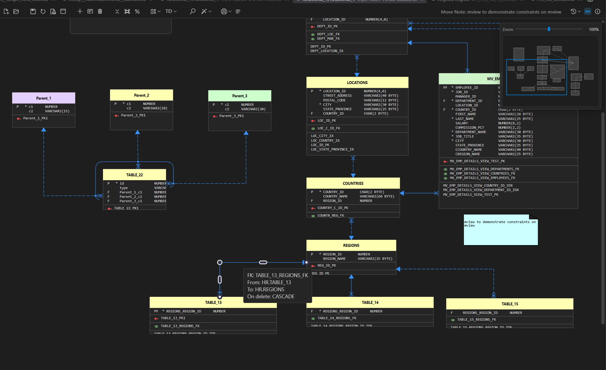
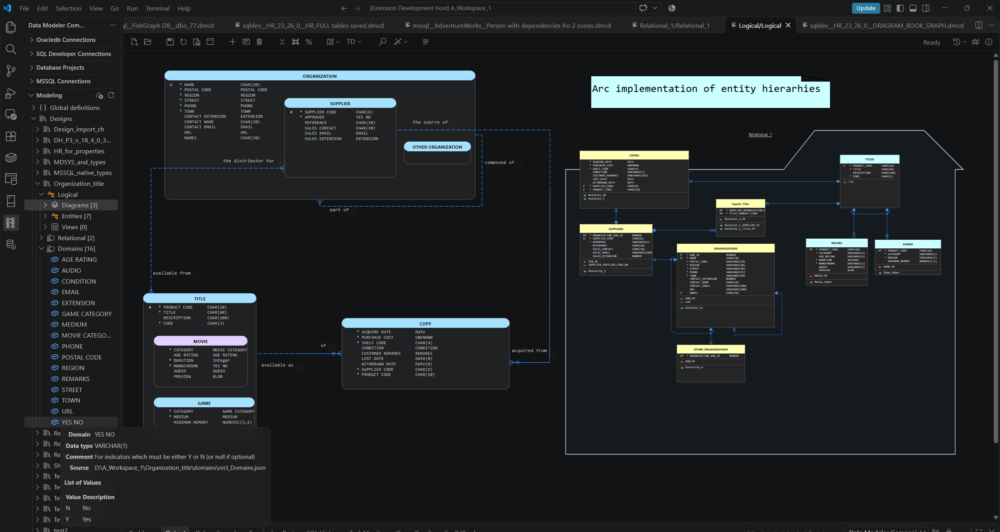
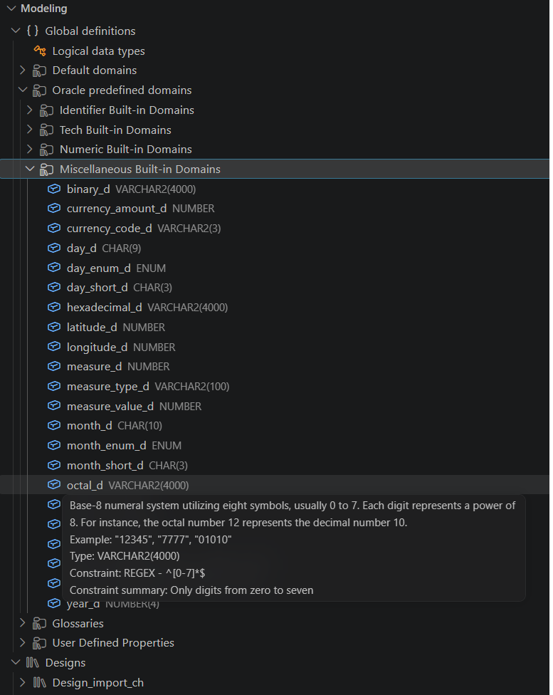
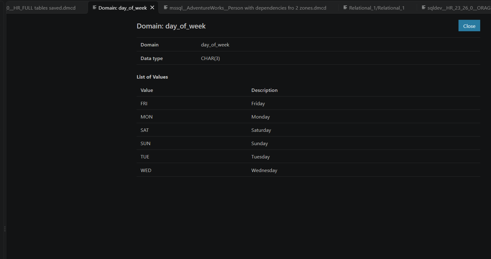
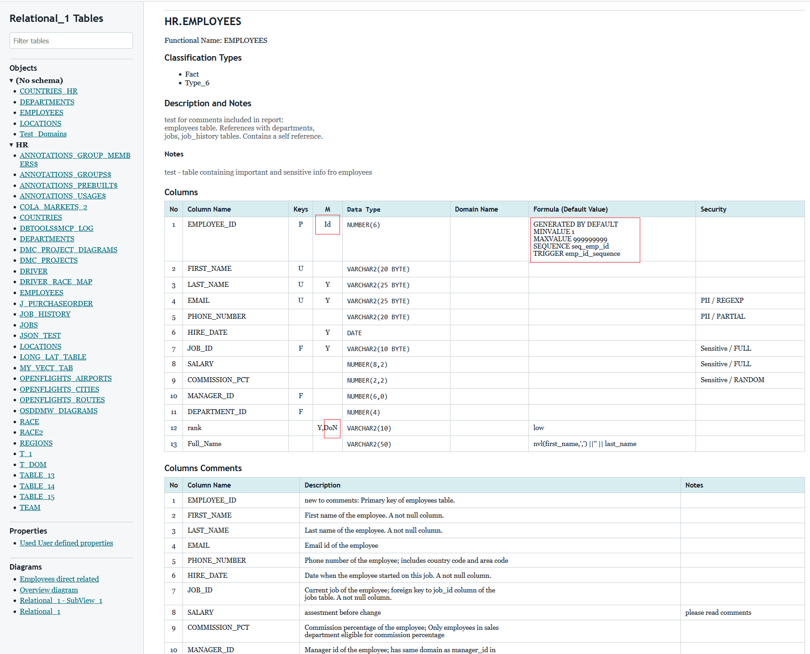
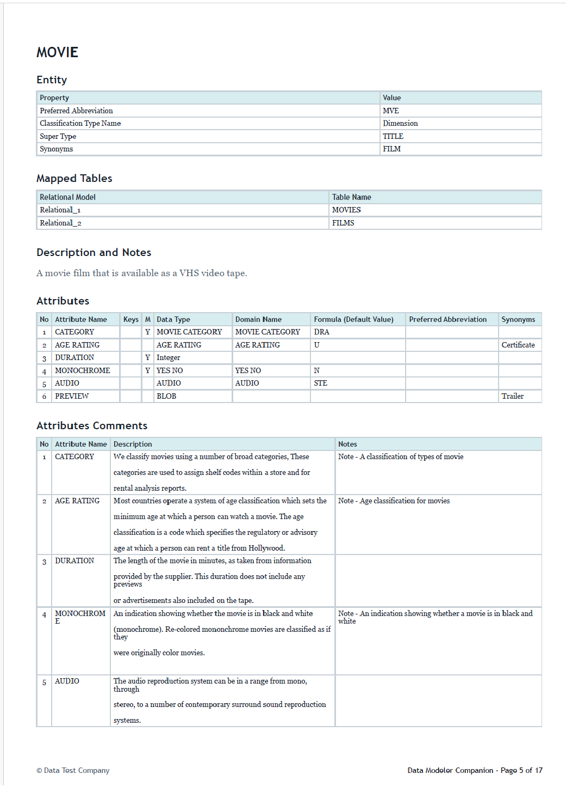

# Modeling and SDDM Designs

Data Modeler Companion imports Oracle SQL Developer Data Modeler (SDDM) designs into the **Modeling** view. The import transfers the documented supported logical and relational artifact scope and preserves supported diagram positions, routes, arcs, colors, notes, and presentation.

## Relational models

Supported relational artifacts include schemas, tables, materialized views, views, columns, keys, indexes, foreign keys, domains, comments, remote-object metadata, and diagram layouts. Relationship and foreign-key arcs preserve how related connectors are organized in the source design.

**Diagram for imported relational model**

## Logical models

Logical diagrams use Barker notation for entities, attributes, and relationships. Entity supertype/subtype hierarchies can be rendered as box-in-box structures while retaining their logical inheritance meaning.

**Logical model diagram - Barker notation with data types visible** and embedded diagram of relational model implementation

## Create and save model diagrams

**Create Diagram (from Current Diagram)** opens a new, unsaved `.dmcmd` editor for either a logical or relational model. It preserves the current display's layout and presentation, remains linked to the same model, and leaves the source diagram unchanged. The new editor tracks changes and supports normal saving and undo/redo, like **Create Diagram from Selected**.

On first save, enter a diagram name. Logical diagrams are stored in `<design>/logical/diagrams`; relational diagrams are stored in `<design>/relational/<model>/diagrams`. The owning folder is fixed and is created if needed. An optional `.dmcmd` suffix is accepted, and replacing an existing file requires confirmation.

Use the diagram's **Save As** action or **Save Model Diagram As...** to save under another name in the same folder. **Ctrl+Shift+S** (**Cmd+Shift+S** on macOS) invokes this action while a model diagram is active. **Ctrl+S** saves an already saved diagram without asking for its name again. Cancelling the name prompt or overwrite confirmation leaves the diagram open with its unsaved changes and modified indicator intact.

Saving under a new name writes the current diagram state to that file and continues editing it, without asking to save the old document. The original file remains unchanged. Entering the current filename performs a normal Save without an overwrite confirmation. If writing or opening the new file fails, the original editor retains its unsaved changes.

First save and Save As retain the diagram's editor group and tab position, leaving neighboring tabs in their existing order.

Explicitly invoking VS Code's built-in **File: Save As...** may still show a file picker; destinations outside the owning model's diagrams folder are rejected.

## Database object details from the tree

Activate a table, view, materialized view, entity, or entity view in the Modeling tree to open its database object details in SQL Developer, just as from a model diagram. **Open Database Object Details** is also available from the object's context menu; **Open as New Diagram** remains a separate action.

The first request for a relational model asks you to select a SQL Developer connection. That choice is reused for the model during the current extension session, including logical objects mapped to it. Right-click the relational model and choose **Change SQL Developer Connection...** to select another connection. These associations are not saved in the design or retained across restarts.

Logical entities and entity views open their mapped relational objects, not objects named after their logical labels. If several relational models are available, select one; that model choice is reused within the design while it remains applicable. Objects without a resolvable mapping show a message instead of opening database details. Relational names, schemas, and kinds come from the model's object index, with an object-file fallback for older designs. An empty schema uses the connection's effective schema.

Tree and diagram navigation share the same database-target selection. Logical entities and entity views without a resolved relational mapping stop with a message in both entry points. A missing target schema is resolved from the selected SQL Developer connection's current schema, then its current user; an explicitly defined object schema is not replaced. If the object is not implemented in that schema, SQL Developer may report a normal open failure. The action does not deploy objects or retry another schema after failure.

Successful opens from either the Modeling tree or a diagram update the **DMC DB Projects Usage Log** with the resolved database object and connection. Opening the same target through either route refreshes its existing row. A successful open means the SQL Developer open command completed successfully, not that object existence or rendered details were independently verified.

This action does not change diagrams. Schema entries, folders, and all domain behavior remain unchanged.

## Data types and relationship presentation

The importer resolves supported SDDM logical and physical data-type definitions, domains, precision, scale, and size. Diagram cards can therefore present database-relevant types rather than unresolved SDDM identifiers.

In the Modeling tree, hover a **Default domains** or design-level **Domains** entry to see its name, logical data type, comment, list of values, and check expressions where available. These domains are not tied to a specific relational model, so the tree does not assume a physical database type; the logical type name is resolved from the configured System Data Types directory when possible.

Relationship attributes and endpoint labels provide semantic information without requiring every detail to remain permanently expanded. Hover information covers objects, attributes, columns, relationships, graph elements, and comments.

- [Data Types Artifact Import](guides/data-types-artifact-import.md)
- [Data Types Artifact Constraints](guides/data-types-artifact-constraints.md)
- [Relationship Attributes and Endpoint Labels](guides/relationship-attributes-and-endpoint-labels.md)

## Oracle built-in domains

**Modeling > Global definitions > Oracle predefined domains** contains a read-only reference catalog of the 109 Oracle AI Database 26ai built-in use case domains. Expand Identifier, Tech, Numeric, or Miscellaneous Built-in Domains to see the domain names and documented types. Hover a domain to see its source description, example, annotation, constraint, domain order, and domain display, where provided. Optional plain-language summaries appear separately from the original rule text. The catalog is bundled with the extension and works without a database connection or SDDM System Data Types directory. It does not create domain objects or assign domains to columns.

This catalog is distinct from SDDM **Default domains** (read from the configured System Data Types directory) and each design's own **Domains**. Source: [Oracle Database Development Guide, section 10.1.12, Tables 10-1 to 10-4](https://docs.oracle.com/en/database/oracle/oracle-database/26/adfns/registering-application-data-usage-database.html#GUID-7638E118-3D00-47B4-AEC1-4AB22FB143AD), Oracle. The checked-in `data/oracle-built-in-domains-26ai.json` groups entries by source table, stores its source URL and review date, and preserves all table cells with whitespace normalized; source `-` cells are `null`. Source expressions and editorial summaries are reference text, not executable SQL or verified database definitions. Check actual database definitions before using them for DDL or validation. Source anomalies are recorded for manual review, not silently corrected.

**Oracle built in domains and tool-tip**

Full details of default domain can be long and difficult to read in tool-tip. Double click on default domain will show its detail in new view with close button. Only one view is used to show details for default domains - double click on another default domain will replace the content of that view.

**Details for default domain**

## Remote objects

Remote object identities and source references recorded by SDDM remain associated with the imported design. **Refresh Remote Objects** updates eligible imported definitions from their recorded source designs while preserving identity and presentation owned by the local design.

## Reports

Generate an interactive HTML report or an A4 PDF for tables and materialized views in a relational model. Reports can include model metadata, dynamic properties, user-defined properties, and the diagrams where each object is used.

**Part of HTML tables report**

PDF generation requires a location of supported Microsoft Edge executable configured in Data Modeler Companion settings. For Windows  MSEdge is preinstalled, related distributions should be installed on Mac and Linux.

**Part of PDF entities report**

[Read the report guide](guides/tables_entities-report.md)

## Requirements

Importing an SDDM design requires the source design folder and access to its compatible SDDM System Data Types directory. On the first import, select the System Data Types folder when prompted; it must contain `types.xml`, and the extension saves the selected path for future imports. Configure the imported-design destination path before running **Import SDDM Design** when the workspace-folder fallback is not suitable.

## Reimporting a design

Right-click an imported design in **Modeling** and choose **Reimport Design from SDDM**. The command reads its recorded SDDM folder, or asks for a folder if that path has moved. A recorded source design ID must match before any changes are made. Reimport requires the configured System Data Types folder.

Reimport replaces the imported logical and relational model definitions, including removing definitions no longer in the source. It does not overwrite or delete existing diagrams, including diagrams you have edited; newly discovered source diagrams are added. Model-linked diagrams use the refreshed definitions when opened, and already-open diagrams refresh after reimport. If a diagram refers to objects no longer in its model, a warning lists them. Available objects still open, and missing placements remain in the saved diagram for manual repair.