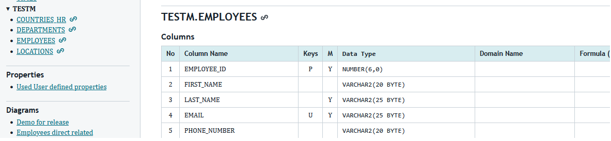
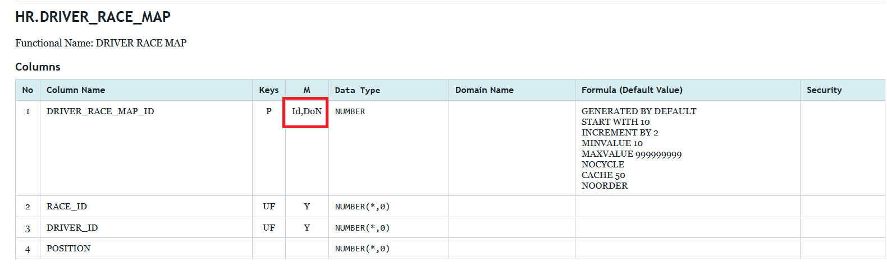

# Reports generated from imported Oracle SQL Developer Data Modeler design
Functionality to generate report appears in context menu on nodes for imported DMC Logical and Relational models.

## Source SDDM design
Relational model is based on reverse engineering of some tables from my test HR schema.
After that relational model is engineered to Logical model.
Logical model is extended by adding new entity Project and defined relationship attributes in relationship with Employee entity.
Source and target labels are set on some of relationships.
**Driver License** entity is added to show non transferable relationship.

## HTML reports require CSS file
If you wonder about strange .css file read [description](../../../docs/guides/tables_entities-report.md#html-output) how it's constructed and how correctly to change appearance with your own `tables-report.custom.css` 
CSS file is used for tables and entities reports.

New elements in tables and entities reports are inclusion of dynamic and user defined properties in content and TOC.

## Tables report
Remote objects are presented in report TOC and in content part with trailing link symbol, on diagram they have usual SDDM presentation with link symbol at top left corner.

New abbreviations appear in column for Mandatory (M) status - Id(identity) and DoN(Default on Null) as well definition of identity/sequence used:

## Entity report

In addition to information in SDDM entities report support for details of relationship attributes is added.

## Download
[Download zip archive](https://github.com/filipsto/dmcompanion/raw/refs/heads/main/examples/reports/modeling/all_reports.zip), extract it in local folder and you can see reports