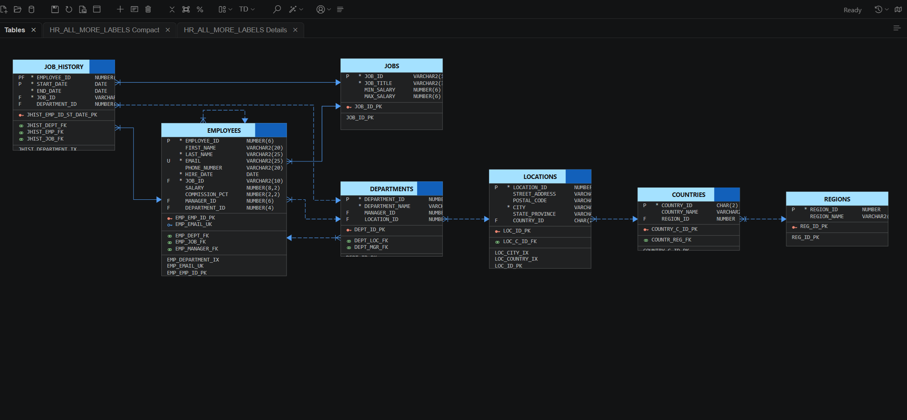
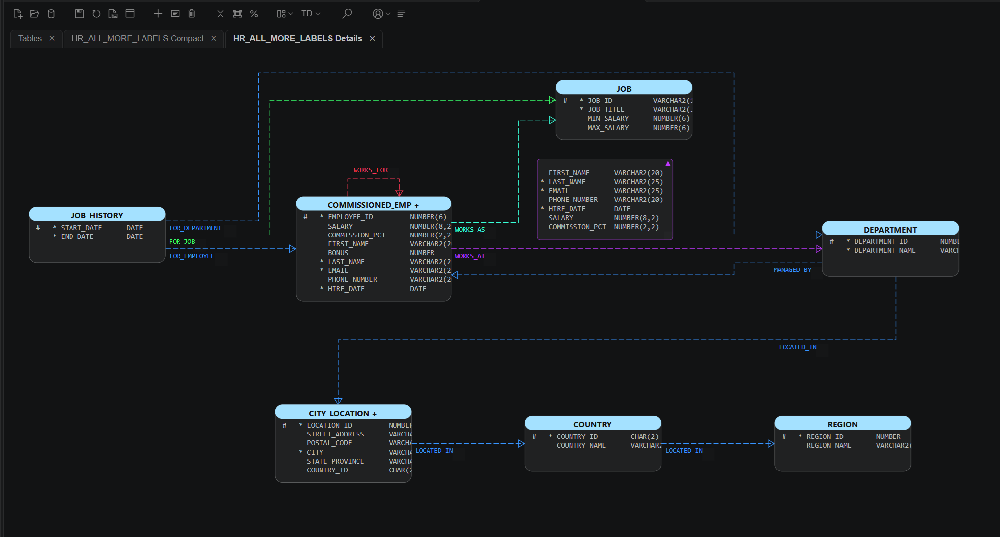
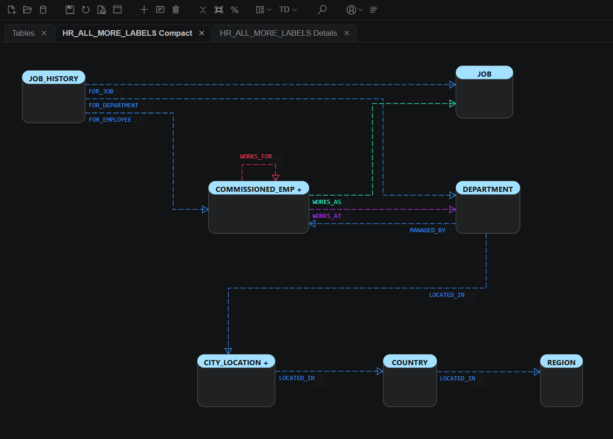

# HR: Oracle Property Graph Diagrams

This example presents an Oracle label property graph based on the HR sample schema in Data Modeler Companion (DMC). It is based on [Getting Started with Property Graphs in Oracle Database 23ai](https://blogs.oracle.com/ace/getting-started-with-property-graphs-in-oracle-database-23ai), a guest article by Deepak Vohra.

The graph connects employees, departments, jobs, job history, locations, countries, and regions using relationships defined over the HR tables.

## Explore the Diagram

Download [Graph_HR_ALL_MORE_LABELS.dmcd](Graph_HR_ALL_MORE_LABELS.dmcd) and open it in VS Code with the Data Modeler Companion extension installed. The self-contained diagram can be viewed without recreating the database. It includes a table display and detailed and compact graph displays.

### Tables

### Graph Details

### Graph Compact

## Recreate the Graph

To create the graph in a database, use Oracle Database 23ai with the HR sample schema installed. See the [Oracle sample schemas repository](https://github.com/oracle-samples/db-sample-schemas) and the article for installation instructions about HR sample schema.

Connect to the HR schema with the necessary privileges and run the [modified property graph definition](PropetyGraph_Oracle_HR_Schema_changed.sql). It creates `HR_ALL_MORE_LABELS` and adds labels such as `COMMISSIONED_EMP`, `CITY_LOCATION`, and `WORK_DEPARTMENT`, as well as a calculated `bonus` property, to the article's example.

The article's original definition creates a graph named `HR` and can be used instead. When trying its queries with the modified definition, change the graph name to `HR_ALL_MORE_LABELS`.