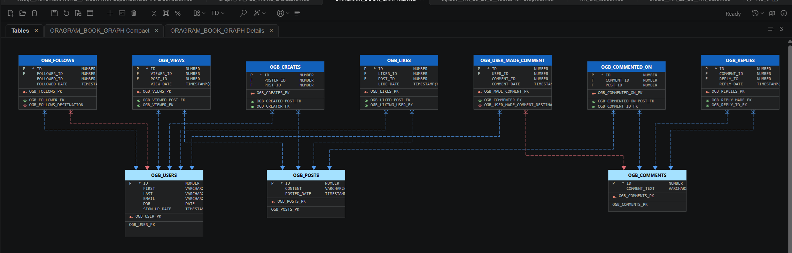
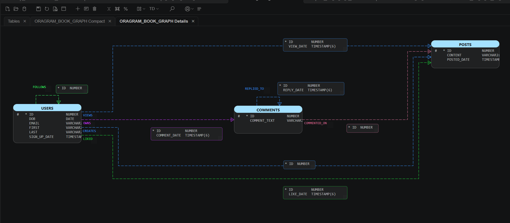
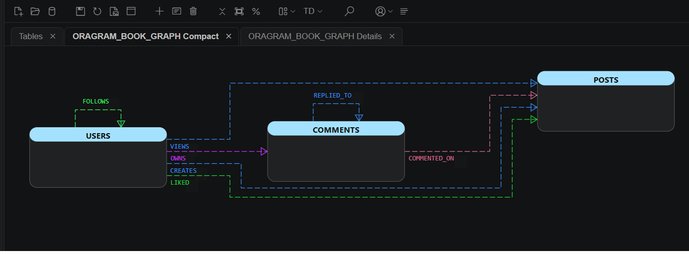

# OraGram: Oracle Property Graph Diagrams

This example presents an Oracle label property graph and its underlying tables in Data Modeler Companion (DMC). It is based on Karin Patenge's [Ora-Gram-Book dataset example](https://github.com/karinpatenge/property-graph/tree/main/Ora-Gram-Book_dataset_example) in the [property-graph repository](https://github.com/karinpatenge/property-graph).

## Explore the Diagram

Download [ORAGRAM_BOOK_GRAPH.dmcd](ORAGRAM_BOOK_GRAPH.dmcd) and open it in VS Code with the Data Modeler Companion extension installed. The self-contained diagram can be viewed without recreating the database. It includes a table display and detailed and compact graph displays.

### Tables

### Graph Details

### Graph Compact

## Implied Foreign Keys

For this example, the upstream [table setup script](https://github.com/karinpatenge/property-graph/blob/main/Ora-Gram-Book_dataset_example/scripts/01_ogb_setup_tables.sql) was modified to omit two foreign key constraints: `ogb_commented_post_fk` and `ogb_followed_post_fk`. The property graph can still define these relationships without the physical foreign keys.

In the Tables display, DMC represents the corresponding graph relationships as implied foreign key (IFK) links. These links visualize graph-defined relationships; they do not create database constraints. The modified setup script is not included in this folder; refer to the upstream example to recreate the dataset and graph.

