# AdventureWorks: Relational and Graph Diagrams

This example shows relational tables and SQL Server graph tables from AdventureWorks in Data Modeler Companion (DMC). It is based on Robert Sheldon's [SQL Server Graph Databases Part 5: Importing Relational Data into a Graph Database](https://www.red-gate.com/simple-talk/databases/sql-server/t-sql-programming-sql-server/sql-server-graph-databases-part-5-importing-relational-data-graph-database/).

The graph represents stores ordering products, sales representatives selling products, and vendors supplying products. Its node tables are `Stores`, `SalesReps`, `Products`, and `Vendors`; its edge tables are `Orders`, `Sells`, and `Supplies`.

## Explore the Diagram

Download [mssql_AdventureWorks_And_Graph.dmcd](mssql_AdventureWorks_And_Graph.dmcd) and open it in VS Code with the Data Modeler Companion extension installed. The self-contained diagram can be viewed without recreating the database. Its displays include the full model, tables with foreign keys, graph tables, and compact and detailed graph views.

### Tables With Foreign Keys

### Graph Tables

### Graph Details

### Graph Compact

## Recreate the Graph

Use article to setup database. It targets `AdventureWorks2017`; change the `USE` statement if your database has a different name. SQL Server 2017 or later and an installed AdventureWorks sample database are required.

Review the script before running it: it creates the `graph` schema and drops and recreates graph tables, deleting any existing data in those tables.

## Generated SQL Examples

The files below show SQL generated from the example database. They target a database named `AdventureWorks` and are provided for inspection and comparison; review and adapt them before execution.

- [Create Script](generated_scripts_and_definitions/AdventureWorks_create_script.sql): generated using the SQL Server (MSSQL) extension's **Create Script** functionality.
- [Minimum definition](generated_scripts_and_definitions/AdventureWorks_definition_minimum.sql): generated with DMC **Show Definition** using minimum details.
- [All details](generated_scripts_and_definitions/AdventureWorks_definition_all_details.sql): generated with **Show Definition**, including additional details without always quoting identifiers or adding `GO` after every statement.
- [All details with quoting and GO](generated_scripts_and_definitions/AdventureWorks_definition_All_details_quoting_and_GO.sql): generated with **Show Definition**, quoting identifiers and using `GO` batch separators.
- [Graph table definitions](generated_scripts_and_definitions/AdventureWorks_definition_Graph_Tables.sql): **Show Definition** output for the graph node and edge tables. Its edge `CONNECTION` clauses describe relationships known to the diagram and may add constraints not present in the original setup script.

See the [SQL Server DDL formatting guide](../../../docs/guides/mssql-ddl-formatting.md) for the available **Show Definition** settings and the [MSSQL extension connections guide](../../../docs/guides/mssql-extension-connections.md) for **Create Script** support.