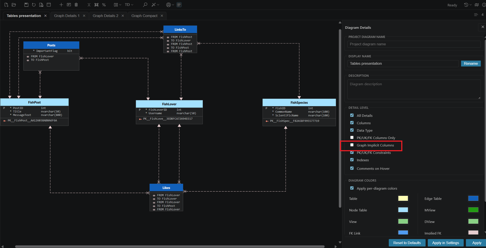
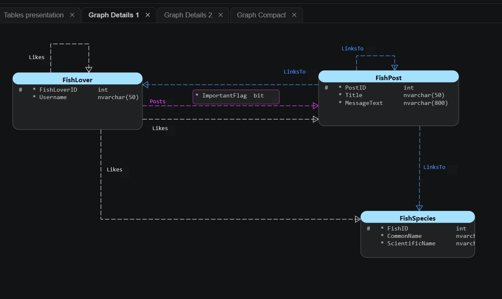
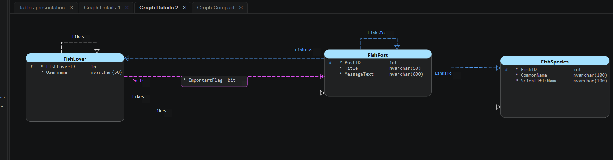
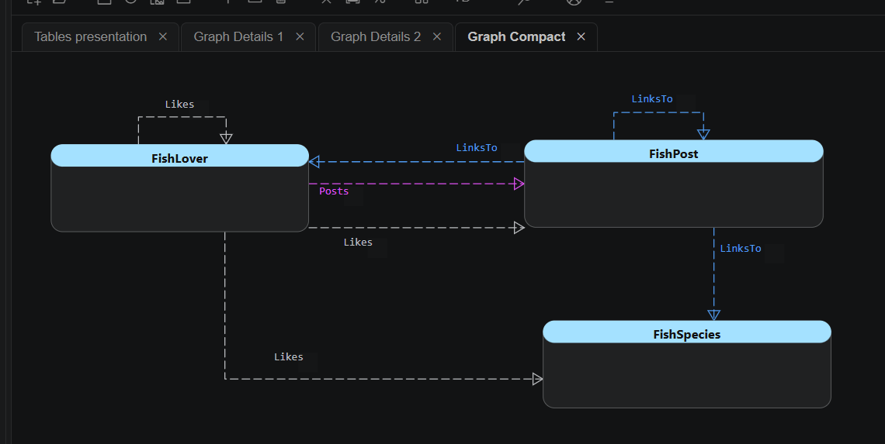

# FishGraph: SQL Server Graph Diagrams

This example presents SQL Server graph tables in Data Modeler Companion (DMC). It is based on Robert Sheldon's [SQL Server Graph Databases Part 1: Introduction](https://www.red-gate.com/simple-talk/databases/sql-server/t-sql-programming-sql-server/sql-server-graph-databases-part-1-introduction/).

The example models a discussion forum using `FishLover`, `FishSpecies`, and `FishPost` node tables and `Likes`, `Posts`, and `LinksTo` edge tables. A single edge table can connect different kinds of nodes, such as a person liking a species, a post, or another person.

## Explore the Diagram

Download [mssql_FishGraph.dmcd](mssql_FishGraph.dmcd) and open it in VS Code with the Data Modeler Companion extension installed. The self-contained diagram can be viewed without recreating the database. It includes a table presentation and three graph displays.

### Tables Presentation

### Graph Details 1

### Graph Details 2

### Graph Compact

## Recreate the Graph

Use source site to setup database site. CONNECTION clause is not used in definition of edge tables. DMC will discover graph relationship based on data in edge tables and will show them on diagram.

**Review** scripts in that series because there are drop database and drop table statements.

For a separate relational-to-graph example, see [AdventureWorks](../AdventureWorks/README.md).
